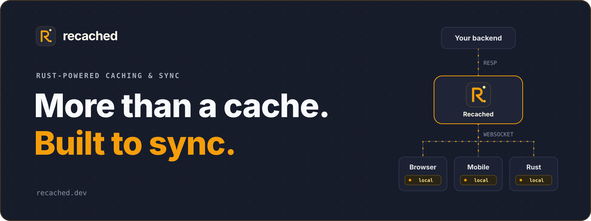
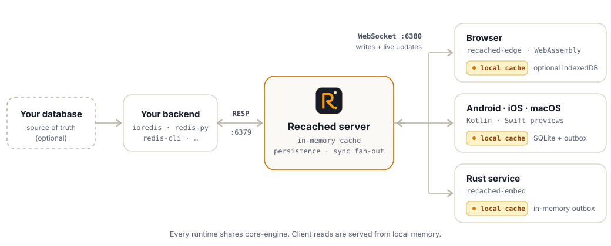

<p align="center">
  <a href="https://recached.dev">
    
  </a>
</p>

<p align="center">
  <b>A Rust-powered caching engine with real-time synchronization built in.</b><br>
  An in-memory cache server your backend uses with its existing Redis client, plus client caches for browsers, Android and Apple apps, and Rust services that read locally and receive updates over WebSocket.
</p>

<p align="center">
  <a href="https://github.com/recached-sh/recached/actions/workflows/ci.yml"></a>
  <a href="https://github.com/recached-sh/recached/releases"></a>
  <a href="https://www.npmjs.com/package/recached-edge"></a>
  <a href="LICENSE.md"></a>
</p>

<p align="center">
  <a href="https://recached.dev"><b>Documentation</b></a> ·
  <a href="https://recached.dev/guide/quick-start.html"><b>Quick start</b></a> ·
  <a href="https://github.com/recached-sh/recached/releases">Releases</a> ·
  <a href="CHANGELOG.md">Changelog</a>
</p>

---

## Why Recached

When a browser, a mobile app or a second service needs the data your backend caches, the usual options each cost something: poll an endpoint and tune the interval, run a separate WebSocket layer with its own reconnect and replay logic, or keep a second client-side cache that you invalidate by hand.

Recached makes the cache and its delivery path one system. Your backend writes as it already does. Subscribed clients receive the change and read it from their own memory. The difference is **where the cache runs**, not a claim about server throughput.

## Core capabilities

- **In-memory cache server.** Strings, expiry, counters, hashes, lists, sets, sorted sets, transactions, pub/sub, JSON documents and rate limiting. Connect ioredis, node-redis, redis-py or `redis-cli` over the supported RESP command subset.
- **Real-time sync, built in.** Clients subscribe to key patterns (`liveQuery` in the browser, `watch` on mobile and in Rust), receive a snapshot and then every change, and re-hydrate after reconnecting.
- **Local reads.** Clients read cached values from application memory instead of making a network request for every read.
- **Offline-capable clients.** Browser clients can persist to IndexedDB; Kotlin and Swift clients persist data and queued writes to SQLite. Writes made offline replay on reconnect, within [outbox limits](https://recached.dev/guide/client-support.html#write-durability-and-replay).
- **Scoped sync access.** Tokens minted by your backend limit which keys each connection may read and write. See [sync scopes](https://recached.dev/server/sync-scopes.html).
- **Server operations.** Snapshots and an optional append-only file, primary/replica replication, TLS, password auth and Prometheus metrics.

> [!NOTE]
> Recached implements a **subset** of Redis commands. Run `COMMAND COUNT` against a live server for the exact surface: 124 in v0.5.2, 134 on `dev`. Notably absent: Lua scripting (`EVAL`), blocking operations (`BLPOP`, `BRPOP`), `LMOVE` and streams (`XADD`). Your Redis client connects unchanged, but libraries built on those primitives — BullMQ, node-redlock, rate-limiter-flexible — will not run. Client SDKs expose smaller APIs than the server.

## How it works

<p align="center">
  <picture>
    <source media="(prefers-color-scheme: dark)" srcset="docs/public/architecture-dark.svg">
    
  </picture>
</p>

Your backend writes over RESP on port 6379. Clients connect over WebSocket on port 6380, receive the keys their live queries and sync scopes cover, and serve reads from local memory. Client writes apply locally and queue for the server; accepted changes fan out to other permitted clients.

Recached is a cache, not a system of record. Keep PostgreSQL or MySQL as the source of truth and publish committed state into Recached: a Recached acknowledgment confirms a cache write, not a SQL commit, and client cache writes do not update SQL. It is not a general CRDT collaboration engine, and its client write queue is not a durable business transaction queue. See [how it works](https://recached.dev/guide/how-it-works.html) and [database integration](https://recached.dev/guide/database-integration.html).

## Quick start

**1. Run the server**

```bash
docker run -p 6379:6379 -p 6380:6380 ghcr.io/recached-sh/recached:latest
```

**2. Write from your backend** with any Redis client:

```javascript
import Redis from 'ioredis'

const cache = new Redis('redis://127.0.0.1:6379')
await cache.set('inventory:item:99', '42')
```

**3. Sync it into a browser** with `npm install recached-edge`:

```typescript
import { createCache } from 'recached-edge'

const cache = await createCache({
  connect: { url: 'ws://127.0.0.1:6380' },
})

cache.liveQuery('inventory:*') // snapshot, then live changes
cache.onKeyChange('inventory:item:99', () => {
  render(cache.get('inventory:item:99')) // a local read
})
```

Each later `SET` from the backend reaches the browser and fires the listener; `cache.get` never leaves the tab. A read can miss before the initial snapshot arrives. These are plaintext development endpoints: a default server has no password, no TLS and no restriction on which web pages may open the sync socket, so read [security](https://recached.dev/server/security.html) before exposing either port.

<details>
<summary><b>Other ways to install</b> — Homebrew, Cargo, Rust, Android, iOS</summary>

```bash
# Homebrew (macOS). The tap is this repository; Homebrew 6+ wants third-party taps trusted.
brew tap recached-sh/recached https://github.com/recached-sh/recached.git
brew trust recached-sh/recached   # Homebrew 6.0+ only
brew install recached && recached-server

# Cargo, from source (the server is not on crates.io)
cargo install --git https://github.com/recached-sh/recached.git recached && recached-server

# Embedded Rust client (Git dependency, unpublished)
cargo add --git https://github.com/recached-sh/recached.git recached-embed
```

```kotlin
// Android, API 24+ (Maven Central)
implementation("dev.recached:recached-android:0.1.2")
```

```swift
// iOS 15+ / macOS 12+ (SwiftPM)
.package(url: "https://github.com/recached-sh/recached-swift", from: "0.1.2")
```

The browser snippet needs `recached-edge` 0.4.0 or later (`onKeyChange`); pair 0.5.x clients with a 0.5 server for every write guarantee. Versions before 0.3.1 do not install at all. Ports are defaults, not fixtures: set `RECACHED_PORT`, `RECACHED_WS_PORT` and `RECACHED_METRICS_PORT` to move them, and `RECACHED_TLS_CERT` plus `RECACHED_TLS_KEY` to serve TLS on both.

</details>

The [quick start guide](https://recached.dev/guide/quick-start.html) continues with Python, live-sync and local-only examples.

## Clients and SDKs

Runtimes do not share identical APIs or guarantees.

| Runtime | Package | Local persistence | Status |
|---|---|---|---|
| Server | Docker, Homebrew, `cargo install --git` | Snapshots, optional AOF | Release candidate for cache workloads |
| [Browser](https://recached.dev/browser/getting-started.html) | `recached-edge` (WebAssembly) | Optional IndexedDB | Sync layer beta |
| [React](https://recached.dev/react/getting-started.html), [Vue](https://recached.dev/vue/getting-started.html) | `@recached/react`, `@recached/vue` | Via `recached-edge` | Sync layer beta |
| [Android](https://recached.dev/android/getting-started.html) | `dev.recached:recached-android` | SQLite data and outbox | 0.1.2 preview |
| [iOS and macOS](https://recached.dev/ios/getting-started.html) | `Recached` via SwiftPM | SQLite data and outbox | 0.1.2 preview |
| [Rust service](https://recached.dev/rust/getting-started.html) | `recached-embed` (Git) | In-memory outbox | Unpublished |

React Native, Flutter and a WASI build for edge runtimes are [planned](https://recached.dev/roadmap.html), not implemented. [Client support and limits](https://recached.dev/guide/client-support.html) compares the adapters.

## Maturity

- **The cache server is a release candidate for cache workloads.** It has persistence, ordered primary/replica replication, TLS, hardened parsers, metrics, and load and chaos tests. It has not completed broad production validation or an independent security audit.
- **The shared sync layer is beta.** Its invariants are [specified](https://recached.dev/server/protocol.html) and tested end to end. Read [sync scopes](https://recached.dev/server/sync-scopes.html) before exposing multi-tenant data.
- **The Kotlin and Swift SDKs are 0.1.2 previews** on the native core of v0.5.1. Their APIs may change before 1.0.
- **Replay after reconnect is bounded.** Deduplicated replay depends on server checkpoint and dedup retention, and duplicate suppression is not exactly-once. See [write durability and replay](https://recached.dev/guide/client-support.html#write-durability-and-replay).
- **`recached-embed` is unpublished.** It works end to end against a live server and has a live test suite, but no production use and no crates.io release.

The road to 1.0 is hardening, not features. Bug reports from production-like use are the most valuable contribution right now.

## Benchmarks

The project's measured performance claim is narrow: **command execution scales across worker threads when writes are spread across keys.** Recached publishes no cross-project throughput or latency comparison, and the numbers below are not one.

One binary, one workload, only `RECACHED_WORKER_THREADS` changed. Intel i5-9400F, `powersave` governor, server pinned to four cores (`PIN=1 SERVER_CPUS=0-3 BENCH_CPUS=4-5`), no persistence. Measured 2026-09-13, before the 0.6 engine changes, with `redis-benchmark` 8.10.1 (`-n 1000000 -c 50 -d 64 -r 100000 -P 16`), in requests per second:

| Worker threads | 1 | 2 | 4 |
|---|---:|---:|---:|
| `GET` | 819,672 | 1,689,189 | 1,658,375 |
| `SET` | 316,857 | 580,720 | 769,823 |
| `INCR` | 330,688 | 602,047 | 761,615 |
| **Total** | **1,467,217** | **2,871,956** | **3,189,812** |
| Change from one thread | baseline | +96% | +117% |

**Hot keys are the other half.** On that build, `redis-benchmark`'s collection tests, which push every operation into one key, *regressed* about 27% from one thread to four. The unreleased 0.6 removes two causes of that drop; a server with persistence, replication or browser clients keeps a replication-ordering lock, so its hot keys gain less. Run [`scripts/bench-scaling.sh`](scripts/bench-scaling.sh) against the commit you deploy. The [benchmark guide](https://recached.dev/guide/benchmarks.html) has the full tables, browser push latency, and memory per key — where Redis and Valkey currently use less memory than Recached for small keys.

## Documentation

| Page | What it covers |
|---|---|
| [Introduction](https://recached.dev/guide/introduction.html) | What Recached is and isn't, maturity, comparisons with Redis, Dragonfly, ElectricSQL and PowerSync |
| [Quick start](https://recached.dev/guide/quick-start.html) | Run a server and connect a backend and a browser client |
| [How it works](https://recached.dev/guide/how-it-works.html) | Hydration, reconnect replay and storage contracts |
| [Client support](https://recached.dev/guide/client-support.html) | Runtime differences, persistence and write durability |
| [Sync scopes](https://recached.dev/server/sync-scopes.html) | Per-connection access control for synchronized keys |
| [Database integration](https://recached.dev/guide/database-integration.html) | Using Recached alongside PostgreSQL or MySQL |
| [Server](https://recached.dev/server/installation.html) | Installation, [configuration](https://recached.dev/server/configuration.html), [security](https://recached.dev/server/security.html) and [operations](https://recached.dev/server/operations.html) |
| [Reference](https://recached.dev/server/commands.html) | Commands, [wire protocol](https://recached.dev/server/protocol.html), [browser API](https://recached.dev/browser/api-reference.html) and [Rust API](https://recached.dev/rust/api-reference.html) |
| [Benchmarks](https://recached.dev/guide/benchmarks.html) | Methodology, results and limits |
| [Roadmap](https://recached.dev/roadmap.html) | Planned work, kept separate from what is implemented |

## Contributing

Bug reports, pull requests and feedback are welcome. Open an issue before large features or architectural changes.

- The server is in `server-native/`, the shared engine in `core-engine/`, the client sync state machine in `sync-client/`, browser bindings in `wasm-edge/` and the native mobile core in `recached-mobile/`. Platform wrappers live in [recached-kotlin](https://github.com/recached-sh/recached-kotlin) and [recached-swift](https://github.com/recached-sh/recached-swift).
- Run `cargo test --workspace` before opening a pull request. For documentation changes, run `pnpm install && pnpm build` in `docs/`.
- Especially welcome: benchmark runs on multi-core server hardware with [`scripts/benchmark.sh`](scripts/benchmark.sh), client examples, and edge cases in the RESP parser, TTL expiry, pub/sub delivery or WebSocket sync.

Security issues: see [SECURITY.md](SECURITY.md). Other questions: [dennis@thinkgrid.dev](mailto:dennis@thinkgrid.dev).

## License

[Apache License 2.0](LICENSE.md) — © 2026 ThinkGrid Labs
