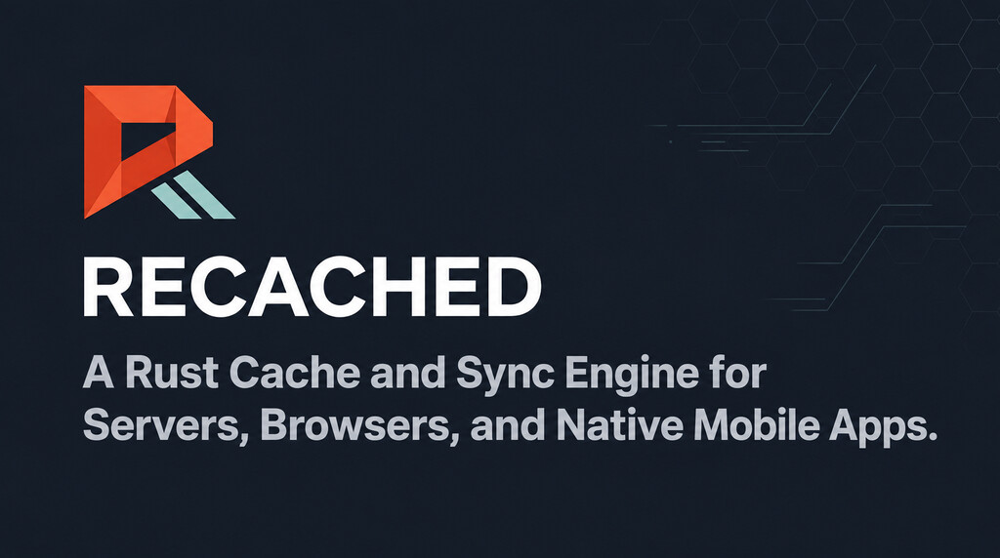
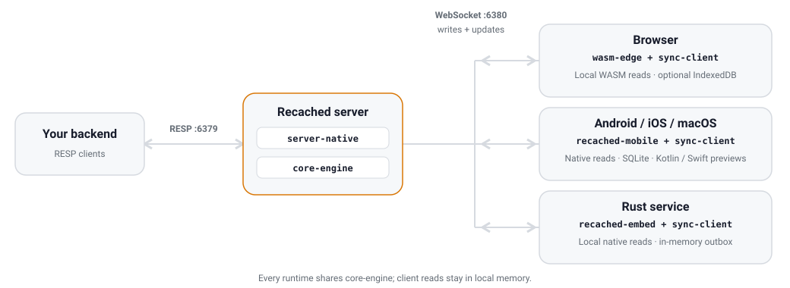

<div align="center">
  
  <h1>Recached</h1>
  <p><b>A local-first cache and real-time sync engine, powered by Rust.</b></p>
  <p>Cache locally. Synchronize everywhere.</p>

  <a href="https://recached.dev"></a>
  <a href="https://www.npmjs.com/package/recached-edge"></a>
  <a href="https://www.rust-lang.org"></a>
  <a href="https://webassembly.org"></a>
  <a href="LICENSE.md"></a>
</div>

---

Recached keeps shared cache data close to your application. One Rust cache engine runs in the server, in browsers as WebAssembly, inside native Android and Apple apps, and in embedded Rust services. Clients read cached values from local memory while updates synchronize between connected clients over WebSocket. Your backend writes to the server with existing Redis clients, using the supported RESP command subset.

## Why Recached

When a browser, mobile app, or second service needs the data your backend caches, the usual options each cost something: poll an endpoint and tune the interval, run a separate WebSocket layer with its own reconnect and replay logic, or keep a second client-side cache that you invalidate by hand. Recached makes the cache and its delivery path one system. The backend writes as it already does; subscribed clients receive the change and read it locally.

The difference is *where the cache runs*, not a claim about server throughput.

- **Local reads.** Read cached values from application memory instead of making a remote request for every read.
- **Real-time sync.** Subscribe to key patterns with `liveQuery` in the browser or `watch` on mobile and in Rust. Clients receive a snapshot, then later changes, and reconcile after reconnecting. [Sync scopes](https://recached.dev/server/sync-scopes) limit which keys each connection may read and write.
- **One Rust foundation.** The server and every client run the same `core-engine`; browser, mobile, and Rust clients share the `sync-client` state machine. Each platform supplies its own transport, persistence, and reactive API.
- **Offline-capable caching.** Browser clients can persist to IndexedDB. Kotlin and Swift clients save data and queued writes to SQLite and restore them after an app restart. Writes made while disconnected queue and replay on reconnect, within [outbox limits](https://recached.dev/guide/client-support#write-durability-and-replay).
- **Familiar backend integration.** Connect ioredis, node-redis, redis-py, or `redis-cli` over RESP. No Recached-specific backend driver is required.

Runtimes do not share identical APIs or guarantees. Persistence, write durability, and the size of the API surface differ by client:

| Application | Client | Local persistence | Status | Getting started |
|---|---|---|---|---|
| Browser | `recached-edge` (WebAssembly), React and Vue adapters | Optional IndexedDB WAL and outbox | Sync layer beta | [Browser](https://recached.dev/browser/getting-started) |
| Android | Kotlin `recached-android`, `Flow` observers | SQLite data and outbox | 0.1.0 preview, Maven Central | [Android preview](https://recached.dev/android/getting-started) |
| iOS / macOS | Swift `Recached`, `AsyncStream` and SwiftUI models | SQLite data and outbox | 0.1.0 preview, SwiftPM | [Apple preview](https://recached.dev/ios/getting-started) |
| Rust service | `recached-embed` | In-memory store and outbox | Git dependency, unpublished | [Rust](https://recached.dev/rust/getting-started) |

See [client support and limits](https://recached.dev/guide/client-support) for differences between adapters. React Native, Flutter, and a WASI build for edge runtimes are [planned](https://recached.dev/roadmap), not implemented.

The server executes commands across worker threads over a sharded keyspace. Scaling depends on your keys being spread across shards; see [benchmarks](#benchmarks) and the [concurrency model](https://recached.dev/server/commands#concurrency-model).

> [!NOTE]
> Recached implements a Redis command subset: strings, expiry, counters, hashes, lists, sets, sorted sets, transactions, pub/sub, and observable keys, plus JSON and rate limiting. Client SDKs expose smaller APIs than the server. Best fit: shared UI state, offline-capable apps, config caches, and rate limiting.
>
> Notably absent: **Lua scripting (`EVAL`)**, **blocking operations** (`BLPOP`, `BRPOP`), **`LMOVE`**, and **streams** (`XADD`). Your Redis *client* will connect unchanged, but libraries built on those primitives — BullMQ, node-redlock, rate-limiter-flexible — ship Lua and will not run. `RLCHECK`/`RLSET` cover rate limiting natively instead. Run `COMMAND COUNT` against a live server for the exact surface (124 entries in this checkout).

## What Recached is — and isn't

**Recached is** a cache and synchronization engine: an in-memory key-value cache server, a local cache runtime for browser, mobile, and Rust clients, and the real-time sync layer between them. Its client caches keep working offline.

**Recached is not** a system of record. It does not replace PostgreSQL or MySQL, is not a local SQL database, and does not implement all of Redis. It is not a general CRDT collaboration engine, it does not synchronize SQL tables in either direction, and its client write queue is not a durable business transaction queue.

Keep your database as the source of truth and publish committed state into Recached as a derived cache. A Recached acknowledgment confirms a cache write, not a SQL commit. See [what Recached is and isn't](https://recached.dev/guide/introduction#what-recached-is-and-isnt) and [database integration](https://recached.dev/guide/database-integration).

**→ Full documentation, use cases, API reference, and guides at [recached.dev](https://recached.dev)**

---

## Install

```bash
# Docker
docker run -p 6379:6379 -p 6380:6380 ghcr.io/recached-sh/recached:latest

# Homebrew (macOS) — the tap is this repo, and Homebrew 6+ wants third-party taps trusted
brew tap recached-sh/recached https://github.com/recached-sh/recached.git
brew trust recached-sh/recached   # Homebrew 6.0+ only; older versions do not have it
brew install recached && recached-server

# Cargo (from source — the crate is not on crates.io yet)
cargo install --git https://github.com/recached-sh/recached.git recached && recached-server
```

```bash
# Browser / Edge (npm)
npm install recached-edge
```

```bash
# Rust service (embedded client — reads come from local process memory)
cargo add --git https://github.com/recached-sh/recached.git recached-embed
```

```kotlin
// Android (Maven Central)
implementation("dev.recached:recached-android:0.1.0")
```

```swift
// iOS / macOS (SwiftPM)
.package(url: "https://github.com/recached-sh/recached-swift", from: "0.1.0")
```

Android needs API 24+; Swift supports iOS 15+ and macOS 12+. See the [Android](https://recached.dev/android/getting-started#install) and [iOS and macOS](https://recached.dev/ios/getting-started#install) guides.

> [!IMPORTANT]
> **Install `recached-edge@^0.4.0`.** Every published version from 0.1.3 to 0.3.0 shipped without
> wasm-pack's `snippets/` directory and failed to import at all; 0.3.1 is the first release that
> installs from npm. `@recached/react` and `@recached/vue` 0.4.0 also use the per-key change
> notifications added in `recached-edge` 0.4.0. See the [changelog](CHANGELOG.md) for details.

---

## How it works

<p align="center">
  <picture>
    <source media="(prefers-color-scheme: dark)" srcset="assets/architecture-dark.svg">
    
  </picture>
</p>

Server changes reach connected clients according to their sync scopes and subscriptions. Client writes apply locally and queue for the server; accepted changes fan out to other clients. Browser and native app reads use local memory. Use `liveQuery(pattern)` in the browser or `watch(pattern)` on mobile to hydrate server data and reconcile missed changes after reconnecting.

A **Rust service** can be one of those connected clients too, via [`recached-embed`](https://recached.dev/rust/getting-started) — same engine, same sync protocol, holding its slice of the cache in its own heap instead of a tab's. Useful for config-shaped data read on every request: fare tables, feature flags, tenant settings, entitlement checks.

If MySQL or PostgreSQL is your source of truth, route business edits through your application API and publish committed state to Recached. Client cache writes do not update SQL automatically. See [database integration](https://recached.dev/guide/database-integration) for read-only projections, transactional outboxes, and offline business edits.

---

## Quick look

**Backend** — a RESP client using the supported command subset, port 6379:

```javascript
import Redis from 'ioredis';
const cache = new Redis('redis://127.0.0.1:6379');
await cache.set('inventory:item:99', '42');
```

**Browser** — WebAssembly, port 6380:

```typescript
import { createCache } from 'recached-edge';

const cache = await createCache({
  persistence: true,                        // survives page refresh via IndexedDB
  connect: { url: 'ws://127.0.0.1:6380' }, // syncs with the server
});

cache.liveQuery('inventory:*'); // initial snapshot, then live updates
cache.get('inventory:item:99'); // may miss before hydration; reads stay local
```

**Android (Kotlin preview)** uses the native Rust core and persists to SQLite:

```kotlin
import dev.recached.Recached
import dev.recached.RecachedConfig
import dev.recached.open

val cache = Recached.open(context, RecachedConfig(url = "ws://127.0.0.1:6380"))
cache.watch("inventory:*")
cache.observeString("inventory:item:99").collect { stock -> render(stock) }
```

**iOS / macOS (Swift preview)** uses the same native core:

```swift
import Foundation
import Recached

let cache = try Recached.open(
    named: "app",
    config: RecachedConfig(url: URL(string: "ws://127.0.0.1:6380")!)
)
cache.watch("inventory:*")
for await stock in cache.observeString("inventory:item:99") {
    render(stock)
}
```

These snippets assume an app context and a `render` function; collect Kotlin flows in a coroutine and iterate Swift streams in an async context. Use the Android emulator's host address or `adb reverse` to reach a development server. Mobile restores saved data before connecting; watch patterns must be registered again on each open. Observers emit the current local value and subsequent changes, coalescing updates for slow consumers.

These examples use plaintext development endpoints. Set `RECACHED_TLS_CERT` and `RECACHED_TLS_KEY`
and the same ports serve TLS — connect with `rediss://` and `wss://` instead. Before exposing either
port beyond localhost, work through
[recached.dev/server/security](https://recached.dev/server/security): a default server has no
password, no TLS, and no restriction on which web pages may open the sync socket.

`6379` and `6380` are defaults, not fixtures — set `RECACHED_PORT` and `RECACHED_WS_PORT` (plus
`RECACHED_METRICS_PORT`) to move them, which is also what running two instances on one host takes.

**The browser half also runs alone.** Drop `connect` and `recached-edge` never opens a socket — the
same engine runs in WASM as a standalone client cache with TTLs, counters, JSON documents, glob
queries, IndexedDB persistence and cross-tab sync, with no Recached server and no backend changes:

```typescript
const cache = await createCache({ persistence: true, broadcastChannel: 'my-app' });
cache.setJSON('user:42', user, 60); // expires on its own, survives a refresh
```

What you give up is what needs a peer: pub/sub, live queries and cross-device sync. See
[use cases: no server at all](https://recached.dev/guide/use-cases#no-server-at-all).

---

## Use cases

**Real-time applications.** Live dashboards and counters, shared application state such as carts, presence and typing indicators, and reactive data in operational consoles. The backend keeps writing with `SET`, `INCR`, or `HSET`; subscribed clients receive the change instead of polling for it.

**Offline-capable applications.** Reference data, configuration, and application state that should stay readable without a network, and that reconciles after reconnecting. On Android and Apple platforms the cache persists across app restarts.

**Backend services.** Feature flags, tenant configuration, entitlement checks, and other small, frequently read, slowly changing data. `recached-embed` holds that slice in your Rust service's memory and heals missed updates after a reconnect, instead of a hand-built `HashMap` plus pub/sub invalidation.

**Without a server.** The browser client also works as a standalone local cache with TTLs, counters, JSON documents, and IndexedDB persistence.

[Use cases](https://recached.dev/guide/use-cases) walks through each pattern, including where Redis, Memcached, or a database is the better choice.

## How it compares

Recached overlaps with several established projects. This summarizes what each is designed for; it is not a performance comparison.

| Project | Designed for | How Recached differs |
|---|---|---|
| Redis / Valkey | Mature centralized cache servers with broad command coverage and a large operational ecosystem. Both support server-assisted client-side caching (`CLIENT TRACKING`). | Recached ships its own client runtimes for browsers, Android, Apple platforms, and Rust. They hydrate watched keys, receive value updates, and replay queued writes after reconnecting; browser and mobile clients also persist locally. Recached implements a smaller command subset. |
| Dragonfly | A multithreaded, Redis- and Memcached-compatible server focused on server-side performance. | Recached's focus is the client cache and its sync path, not server throughput. |
| ElectricSQL | Synchronizing subsets of PostgreSQL data to clients. | Recached synchronizes a cache keyspace, not database tables. You publish database-derived state into it. |
| PowerSync | Synchronizing backend database data into an on-device SQLite database, with client writes uploaded through your backend. | Recached's client store is a key-value cache, not a local SQL database. |

Use Recached when you want one cache engine across runtimes, local reads, and live key updates without assembling those pieces yourself. It also runs alongside Redis: keep server-only caching, queues, and sessions in Redis and move only the client-visible slice to Recached.

---

## Benchmarks

Recached's measured performance claim is narrow: command execution scales across worker threads. The project publishes no cross-project performance comparison, and these numbers are not one — they say nothing about how any other cache performs on this or any host.

The scaling run below changed only `RECACHED_WORKER_THREADS`. One binary, one workload, one fixed four-core CPU set — Intel i5-9400F, `powersave` governor, `PIN=1 SERVER_CPUS=0-3 BENCH_CPUS=4-5`, no persistence. Measured 2026-09-13 with `redis-benchmark` 8.10.1 (`-n 1000000 -c 50 -d 64 -r 100000 -P 16`):

| Worker threads | 1 | 2 | 4 |
|---|---:|---:|---:|
| `GET` | 819,672 | 1,689,189 | 1,658,375 |
| `SET` | 316,857 | 580,720 | 769,823 |
| `INCR` | 330,688 | 602,047 | 761,615 |
| **Total, keys spread over 100k** | **1,467,217** | **2,871,956** | **3,189,812** |
| Change from one thread | baseline | +96% | **+117%** |

**Scaling requires your writes to be spread across keys.** `redis-benchmark`'s collection tests (`LPUSH`, `SADD`, `HSET`, `ZADD`) push every operation into a single key, and that workload does not scale — it *regresses* about 27%, from 1,550,566 req/s on one thread to 1,134,772 on four, because one key lives on one shard and extra workers only add contention. Which half describes your deployment depends on whether you have hot keys. See [the benchmark guide](https://recached.dev/guide/benchmarks) for both tables.

One thread is the baseline the ratio is measured against, not a recommended deployment. This is evidence for parallel command execution on this build and host, nothing wider. Run [`scripts/bench-scaling.sh`](scripts/bench-scaling.sh) against the commit you plan to deploy.

On the same host, a server-side write reaches a subscribed browser over WebSocket in **151 µs at p50** (p99 698 µs) — measured with the project's own harness, since no RESP benchmark can see that path. Browser *reads* are a local WebAssembly memory lookup and never leave the tab.

Browser, mobile, and embedded Rust clients all read locally. The measurements above cover the server and browser sync path; they are not native mobile latency measurements.

## Maturity

Being honest about where things stand:

- **The cache server is a release candidate for cache workloads.** It includes persistence, ordered primary/replica replication, TLS, hardened parsers, metrics, and load/chaos tests. It has not completed broad production validation or an independent security audit. Treat it as a cache, not a system of record.
- **The shared sync layer (browser, mobile, and Rust clients) is beta.** Its invariants are [specified](https://recached.dev/server/protocol) and tested end-to-end. Read [Sync Scopes](https://recached.dev/server/sync-scopes) before exposing multi-tenant data.
- **The Kotlin and Swift SDKs are 0.1.0 previews**, published to Maven Central and SwiftPM on the native core of v0.4.0. They implement local reads, SQLite persistence, queued writes, reconnect recovery, and reactive observers; their APIs may change before 1.0. Deduplicated replay is bounded by server checkpoint and dedup retention; see [client limits](https://recached.dev/guide/client-support#write-durability-and-replay).
- **The embedded Rust client (`recached-embed`) is brand new and unpublished** — it works end-to-end against a live server and is covered by a live test suite, but it has no production miles and is not on crates.io.

The road to 1.0 is hardening, not features. Bug reports from production-like use are the most valuable contribution right now.

## Documentation

- [Introduction](https://recached.dev/guide/introduction): what Recached is and isn't, maturity, and comparisons
- [Quick start](https://recached.dev/guide/quick-start): run a server and connect a backend and a browser client
- [Client support](https://recached.dev/guide/client-support): runtime differences, persistence, and write durability
- [How it works](https://recached.dev/guide/how-it-works): hydration, reconnect replay, and storage contracts
- [Database integration](https://recached.dev/guide/database-integration): use Recached alongside MySQL or PostgreSQL
- [Server](https://recached.dev/server/installation): installation, [configuration](https://recached.dev/server/configuration), [commands](https://recached.dev/server/commands), [security](https://recached.dev/server/security), and the [wire protocol](https://recached.dev/server/protocol)
- [Roadmap](https://recached.dev/roadmap): planned features, kept separate from what is implemented

---

## Contributing

Bug reports, PRs, and feedback are all welcome.

1. Fork the repo and create a branch: `git checkout -b feat/my-feature`
2. Make your changes: server logic lives in `server-native/`, browser bindings in `wasm-edge/`, shared sync in `sync-client/`, and the native client core in `recached-mobile/`. Platform wrappers live in [recached-kotlin](https://github.com/recached-sh/recached-kotlin) and [recached-swift](https://github.com/recached-sh/recached-swift).
3. Run `cargo test --workspace` before opening a PR
4. Open a pull request with a clear description

Open an issue before large features or architectural changes. Areas where contributions are especially welcome:

- **Benchmarks** — run [`scripts/benchmark.sh`](scripts/benchmark.sh) on multi-core server hardware and share the results
- **Client examples** — browser demos, and apps beyond the checklist demos in [recached-kotlin](https://github.com/recached-sh/recached-kotlin/tree/main/demo) and [recached-swift](https://github.com/recached-sh/recached-swift/tree/main/Demo)
- **Bug reports** — edge cases in the RESP parser, TTL eviction, pub/sub delivery, or WebSocket sync

See [recached.dev/roadmap](https://recached.dev/roadmap) for what's planned.

Reach out: [dennis@thinkgrid.dev](mailto:dennis@thinkgrid.dev)

## License

Apache License 2.0 — © 2026 ThinkGrid Labs
