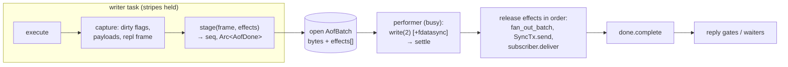
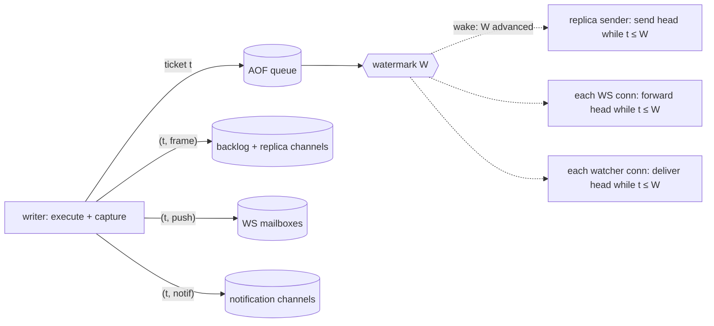
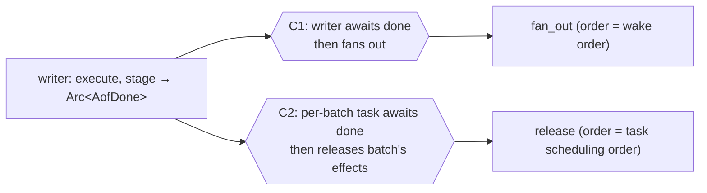
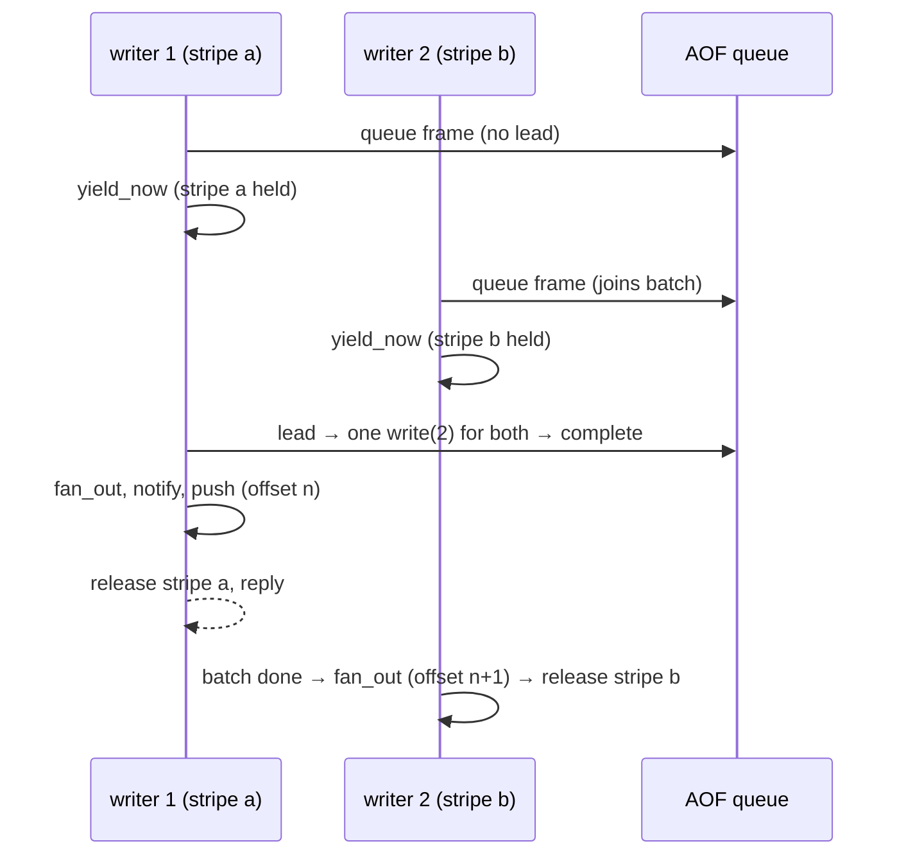

# v0.6.0 Phase 6N-B: architecture alternatives

**Source:** `dev` `a90e08d`.

Four designs are compared against the same requirement: batch AOF writes when a replica, WebSocket route, watcher or live query observes them, without weakening G1–G10 / N1–N12 ([invariants](V0.6N-B-ORDERING-INVARIANTS.md)).

**Naming.** PR #121 called the watermark idea "Option D". Here it is **Option A**. "Option D" below is a different, smaller design that the current code suggests.

**All CPU and throughput figures in this document are estimates.** They extrapolate from 6N-1's measured differences (§1 of the [current architecture](V0.6N-B-CURRENT-ARCHITECTURE.md)), not from profiles. The [validation plan](V0.6N-B-VALIDATION-PLAN.md) replaces them with measurements.

---

## Option A — Ordered commit batch (effects ride in the AOF batch)

The writer stages its AOF frame **and** its observer effects into the same open `AofBatch` in one queue-lock acquisition, then drops its stripes. Whoever performs the batch already holds the exclusive writer role (`busy`). After the batch is settled, that performer releases the batch's effects in seq order, and only then completes the batch's `AofDone`.

**Sequence:**
1. Under the stripes: execute and capture.
2. `stage()`: one queue lock; assigns seqs; appends bytes and effects.
3. Drop the stripes.
4. Wait for the reply gate. On TCP this is the existing `AofGatedWriter`, including coalescing. On WS it is an await of `done` with one coalescing yield.
5. Performer: perform, then settle, then **release**, then clear `busy`, then complete.

**Source changes:**
- `persistence.rs`:
  - effects vector in `AofBatch`;
  - `stage()`;
  - release in `lead`/`drain_blocking`;
  - watermarks;
  - pending cap;
  - `quiesce()`.
- `server_state.rs`: `on_write_logged` and `log_dedup_outcome` stage instead of append + `fan_out`.
- `replication.rs`:
  - `fan_out_batch`;
  - drained barrier in `handle_replica`.
- `propagation.rs`:
  - capture split from delivery for watchers;
  - frame-less notifications staged.
- `watch.rs`: `WatchSubscriber::prepare`/`deliver`, and a dirty flag.
- `connection.rs`:
  - EXEC reads the dirty flag;
  - QSUB uses the drained barrier;
  - `+DUP` gating;
  - WS awaits `done`.

**Ordering:**
- Conflicting writes get seqs in stripe order (N1).
- One exclusive performer releases batches in queue order, and each batch in seq order (N2). Every observer FIFO therefore sees AOF order.
- This is **stronger** than today: replication offsets now follow AOF order for independent writes too.

**Failure behaviour:**
- `always` failure: `fail_stop` exits on the performer before release, so nothing escapes (N9).
- `everysec` failure: the batch settles with an error and is released, as today's inline path does (G3).
- Torn write: cut-back is unchanged. Partial batches are not split (see the [failure analysis](V0.6N-B-FAILURE-MODE-ANALYSIS.md)).

**CPU:**
- Removes the per-command `write(2)` (about 6 µs at 1.0 writes/command).
- Amortizes the stream mutex to one acquisition per batch.
- Still pays per frame: an `Arc` frame, a backlog push and one `try_send` per replica.
- Adds per write: one `StagedEffect` push (one `Vec` growth amortized), and a dirty-flag store per watcher.
- **Estimate:** 7–8 µs/op on the 6N-1 replicated workload, against 14.02 today.

**Memory:**
- The staged effects hold what today's inline path holds for the same write during its `write(2)`. They are held for the batch's lifetime instead of one syscall.
- Capped globally (N10).
- Notification payloads are charged to the existing per-connection budgets at capture.

**Complexity:**
- Moderate to high: about 6 files, and four new mechanisms (N4–N7, N12).
- No new task type, no new lock order, no protocol change.

**Security risks:**
- Delayed delivery widens the time between authorization and delivery. Mitigated by N11: authorization is already decided at dequeue, and revocation closes the connection.
- Release runs on whatever thread performs: a tokio worker, or the blocking pool under `always`. Every release operation must be synchronous and non-blocking.

**Testability:**
- Good. The performer is a single function.
- Deterministic hooks: "pause after stage" and "pause between perform and release" (`cfg(test)`), in the style of the existing `unordered_pause` and `AofFault`.

**Rollback:** `RECACHED_AOF_FANOUT=inline` keeps today's code paths untouched. Staging is used only when the switch selects it.

---

## Option B — Separate propagation queues with commit tickets

The AOF issues a ticket per write. The replication stream, mailboxes and notification channels receive their items **at capture time**, tagged with the ticket. Each consumer holds an item until a global watermark passes its ticket.

**Ordering:**
- Items enter the consumer queues in stripe order, so conflicting writes are FIFO-ordered.
- Replication **offsets are assigned at capture**, before the AOF stage. The backlog then holds unreleased frames, and `resume_frames`, `max_lag_frames` and the replica sender must all filter on `t ≤ W`.
- Head-of-line blocking per queue keeps the order. The cross-queue order is the same as today.

**Failure behaviour:**
- `always` fail-stop: the process exits; no consumer passes `W`.
- `everysec` failure: `W` must still advance past the failed batch, or every consumer stalls.
- Partial resync can hand a replica a frame with `t > W` unless the filtering is exact. That is a new way to break G3.

**CPU:**
- Every consumer wakes when `W` advances. With N WS connections that is N wake-ups per batch, even for connections whose head is not yet eligible.
- The 6I history (one push per `select!` cycle disconnecting browsers) shows this cost class is real.
- Ticket checks happen on every dequeue.

**Memory:** Pending items sit in consumer queues and count against their budgets, so a slow AOF can trip consumer overflow (disconnects) that today only a slow consumer causes.

**Complexity:** High. It touches every consumer loop (replica sender, WS handler, TCP/WS watch arms) and the backlog.

**Security:** Every consumer gains a second gate. Any consumer that forgets the ticket check leaks a pre-AOF write. More code paths to review.

**Testability:** Each consumer needs its own gating test. Out-of-order completion is not possible (batches complete in order), but this design does not exploit that.

**Rollback:** Feature switch. Consumer loops carry dual logic.

**Verdict:** **Rejected.**
- It spreads the gate over every consumer.
- It puts unreleased frames into the backlog.
- It multiplies wake-ups.

It buys nothing over A, because AOF batches already complete strictly in order.

---

## Option C — Batch completion callbacks / shared completion handles

Each batch owns its completion (`Arc<AofDone>` already exists). Subsystems hold the handle and act when it completes. Either the writer task awaits `done` and then fans out (variant C1), or a per-batch task does it (variant C2).

**C1, writer awaits `done`, then fans out, stripes released before the wait.**
- **Breaks G2.** `w1` and `w2` on one key, in one batch, wake in arbitrary order, so `w2`'s replica frame can precede `w1`'s.
- Keeping the stripes across the await restores the order but is no longer a deferral: it becomes Option D.

**C2, one task per batch awaits and releases.**
- Batches complete in order, but tasks are scheduled in any order, so batch `k+1`'s release can run before batch `k`'s.
- It needs a sequencer (release turn = batch index), which is Option A with an extra task hop and a wake-up per batch.

**Allocation:**
- C1: no extra allocation, but per-command fan-out remains.
- C2: one task per batch, about 1 µs of spawn and wake each.

**Shutdown:**
- C2 tasks outstanding at shutdown must be awaited or dropped.
- Dropped means effects never released: replicas miss frames the AOF has. They will resync, but WS clients would silently diverge until a gap is detected.

**Verdict:** **Rejected** as a standalone design. C1 is unsafe without the stripes; C2 reduces to A plus overhead.

---

## Option D — Coalesced inline commit (no deferral)

Keep today's structure exactly: stripes held through the append and the fan-out. Only the immediate lead in `append` becomes a coalesced lead:
1. queue the frame;
2. `yield_now` once (the existing `Coalescer`, with its adaptive back-off);
3. lead;
4. wait;
5. fan out.

Other writers that are ready on the worker queue their frames into the same batch during the yield. The first to resume writes the batch for all of them.

**Source changes:** `persistence.rs`, a `append_coalesced()` that reuses `Coalescer`; `server_state.rs`, use it when `RECACHED_AOF_FANOUT=coalesced`. That is about 40 lines plus tests.

**Ordering:**
- **Identical to today.** Every effect still runs under the writer's stripes, after its own append returned.
- G1–G10 are untouched.
- None of N4–N7 or N12 is needed: dirtiness, cuts and `+DUP` behave exactly as now.

**Failure behaviour:** Identical to today's inline path. Under `always` it is already group-committed through the blocking drain.

**CPU:**
- Removes most of the `write(2)` cost **when several connections are ready on a worker**.
- Keeps the per-frame fan-out (about 2 µs) and adds a scheduler pass per yield. The back-off bounds that pass for lone writers.
- **Estimate:** 8–9 µs/op on the 6N-1 replicated workload.

**What it does not fix:**
- **Pipelines.** A connection still waits per command, so P=16 batches only across connections: about 50 frames per write rather than about 166.
- **Stripes held across the yield and the syscall.** A hot key serializes on it, as today, plus one scheduler pass. Barriers (expiry chunks, QSUB, sync) wait one extra pass.
- **Four workers.** Coalescing is the same 2.2 commands per write (6N-1 Test A).

**Memory:** Unchanged; each writer still waits.

**Complexity / security:** Minimal; no new observable states.

**Testability:** The existing gate tests apply ("50 ready connections share ≤ 3 writes").

**Rollback:** Switch back to `inline`; the code path is otherwise shared.

---

## Comparison

| | A: ordered commit batch | B: per-queue tickets | C: completion handles | D: coalesced inline |
|---|---|---|---|---|
| Removes per-command `write(2)` (P=1, many conns) | yes | yes | yes | yes |
| Batches within a pipeline (P=16) | **yes** | yes | yes | no |
| Amortizes fan-out locking | **yes** (per batch) | partly | no | no |
| Stripe held across AOF I/O | **no** | no | C1 must, C2 no | yes (as today) |
| Replication offset order | AOF order (stronger) | capture order | arbitrary (C1) | as today |
| New invariants to enforce | N4–N7, N10, N12 | N5–N7, plus a gate in every consumer, backlog filtering | sequencer | **none** |
| Wake-ups per batch | 1 performer | N consumers | 1 task per batch (C2) | as today |
| Estimated µs/op (6N-1 replicated, today 14.0) | 7–8 | 8–9 | — | 8–9 |
| Complexity | moderate–high | high | moderate | **low** |
| Correctness risk | moderate, contained in one performer function | high | high (C1) | **low** |
| Rollback | feature switch | feature switch | — | feature switch |

## Selection

- **The watermark architecture: Option A.**
  - It is the only alternative that gives pipeline batching, amortized fan-out and stripes free of I/O without spreading a gate over every consumer.
  - Its additional invariants concentrate in one place, the performer's release step, plus four well-defined call sites: EXEC's dirty check, the drained barrier, `+DUP` and frame-less notifications.
  - B is rejected (§B), and C reduces to A (§C).
- **Recommended order: Option D first, behind the same switch** (`RECACHED_AOF_FANOUT=coalesced`). The reasons:
  1. It is the low-risk part of the benefit.
  2. It gives a measured A/B point.
  3. Option A then has to beat it, not just today's inline path.
  4. It stays useful as the fallback if A's later PRs are delayed.

  A proceeds only if D's measurement leaves a material gap; the threshold is in the [design decision](V0.6N-B-DESIGN-DECISION.md).

**The case against doing only D:** D leaves pipelined replicated workloads (P=16) and multi-key hot paths largely where they are. It also keeps a syscall inside the stripe hold, which is the latency-sensitive part of the p99 regression (1.21 ms against 0.54 ms). A is the design that fixes both.
