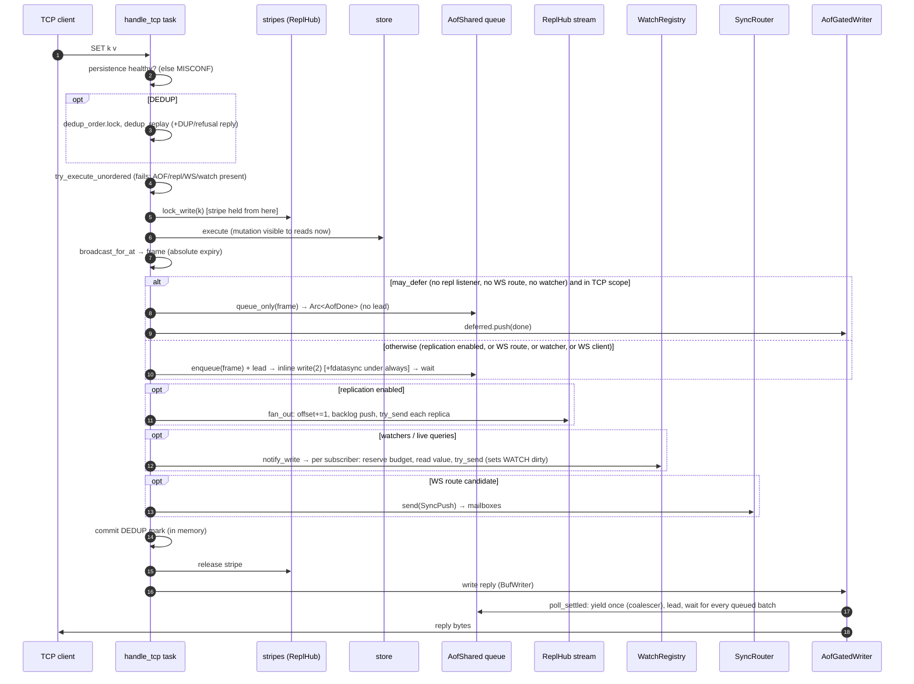
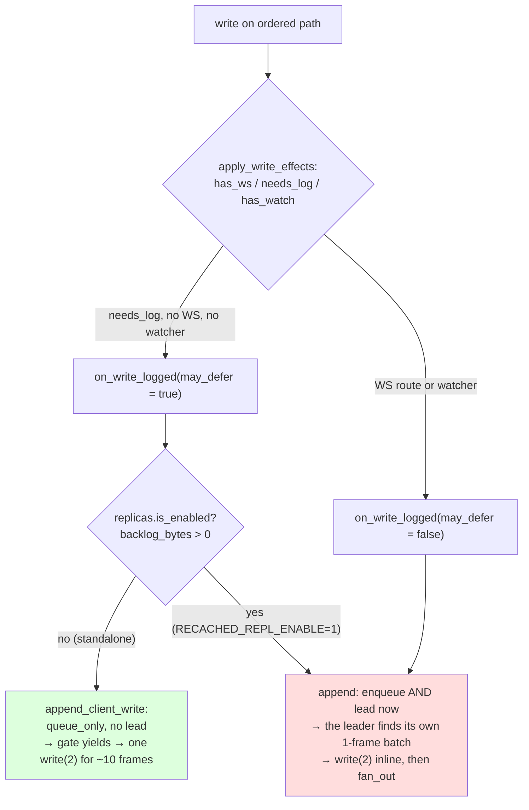

# v0.6.0 Phase 6N-B: current mutation, persistence and propagation pipeline

**Source:** `dev` at `a90e08d41530b170b8a750768dbcd3423ba2c193` (merge of #126, 2026-11-19). The `server-native/` tree is the one 6N-1 measured as the RC (`e6fcd5b`); #126 changed only `benchmarks/`.

All line references are to that commit. Read-only inspection; nothing was changed.

## 1. Baseline evidence reused

| Measurement (6N-1, native Fedora, i5-9400F) | standalone AOF | replication enabled + 1 replica |
|---|---:|---:|
| SET, 1 worker, 50 clients, P=1, `everysec` | 121,197 rps | **54,031 rps (0.45×)** |
| µs primary CPU / request | 6.00 | **14.02** |
| AOF `write(2)` per command | 0.10 | **1.00** |
| p99 | 0.543 ms | 1.207 ms |
| replica lag p50 / p99 | — | 0.34 / 1.80 ms |

Sources:
- [`V0.6N-1-REPLICATION-AOF-PROFILE.md`](../6n-1/V0.6N-1-REPLICATION-AOF-PROFILE.md);
- [`V0.6N-1-TARGETED-AOF-PERFORMANCE.md`](../6n-1/V0.6N-1-TARGETED-AOF-PERFORMANCE.md): coalescing off gives 64.5k rps and about 11.9 µs/op.

**Rough cost split of the replicated path:**

| Component | Cost per write | Derivation |
|---|---:|---|
| Uncoalesced `write(2)` | about 6 µs | 11.9 − 6.0 |
| Per-frame fan-out | about 2 µs | 14.0 − 11.9 |

These are estimates from differences between runs, not profiles. The host had no `perf`.

**Documents the brief cites but that do not exist.** These are not in any branch:
- `V0.6M-AOF-GROUP-COMMIT-DESIGN.md`
- `V0.6M-REPLICATION-PERSISTENCE-REVIEW.md` (the "G1–G10" invariants)
- `V0.6N-0-AOF-ALWAYS-FAILURE-CONTRACT.md`
- `V0.6N-0-CORRECTNESS-SECURITY-REVIEW.md`

6N-1 found the same ([`V0.6N-1-EXISTING-EVIDENCE.md`](../6n-1/V0.6N-1-EXISTING-EVIDENCE.md)). The records that do exist:

| Record | What it holds |
|---|---|
| PR #121 | Group commit and coalescing. It names "Option D: watermark-gated fan-out" as the next bottleneck |
| PR #122 / #123 | Torn-write cut-back; 6M review findings F1–F4, R1–R4 |
| PR #125 | The `always` fail-stop contract; review findings F1–F6 |
| `docs/server/configuration.md` §AOF failures | Policy table |
| `docs/server/protocol.md` §DEDUP | Write order |
| Source comments | Guarantees stated in the code |

[`V0.6N-B-ORDERING-INVARIANTS.md`](V0.6N-B-ORDERING-INVARIANTS.md) reconstructs a G1–G10 baseline from these records.

## 2. Components

| Component | Where | Role |
|---|---|---|
| `AofWriter` / `AofShared` | [`persistence.rs:255`](../../../server-native/src/persistence.rs#L255) | Shared batch queue (`std::sync::Mutex<AofQueue>`), exclusive performer (`busy` flag), `perform`/`settle`/`fail_stop` |
| `AofBatch`, `AofDone` | [`persistence.rs:456`](../../../server-native/src/persistence.rs#L456), [`:471`](../../../server-native/src/persistence.rs#L471) | Bytes in append order plus one shared completion (`OnceLock` result + `Notify`) |
| `Coalescer` | [`persistence.rs:396`](../../../server-native/src/persistence.rs#L396) | One `yield_now` before leading; adaptive back-off (2 misses → 32 immediate leads) |
| `AofGatedWriter`, `DeferredAof` | [`persistence.rs:1095`](../../../server-native/src/persistence.rs#L1095), [`:1050`](../../../server-native/src/persistence.rs#L1050) | A TCP connection's socket writer. Every socket write first waits for the batches this connection queued |
| `append` / `append_client_write` / `flush` / `truncate` | [`persistence.rs:1377`](../../../server-native/src/persistence.rs#L1377)–[`1452`](../../../server-native/src/persistence.rs#L1452) | Inline append (lead now, wait); deferred append (queue, wait at the gate); fsync barrier; checkpoint truncation |
| `execute_ordered_write` | [`propagation.rs:365`](../../../server-native/src/propagation.rs#L365) | Health check, DEDUP order lock, unordered fast path, stripe selection, execute, DEDUP mark commit |
| `apply_write_effects_identified` | [`propagation.rs:1284`](../../../server-native/src/propagation.rs#L1284) | Decides `may_defer`; AOF + replication, then WATCH/QSUB, then WebSocket push |
| `ServerState::on_write_logged` | [`server_state.rs:633`](../../../server-native/src/server_state.rs#L633) | **The inline-vs-deferred decision** and the replication fan-out |
| `ReplHub` | [`replication.rs:71`](../../../server-native/src/replication.rs#L71) | 256 `tokio::sync::Mutex` write-order stripes, `UnorderedGate`, the stream mutex (backlog + replica senders), the offset counter |
| `ReplHub::fan_out` | [`replication.rs:333`](../../../server-native/src/replication.rs#L333) | Under the stream mutex: assign the offset, push to the backlog, trim it, `try_send` to every replica (drop a replica on a full channel or byte budget) |
| `handle_replica` | [`replication.rs:900`](../../../server-native/src/replication.rs#L900) | Auth, resume handshake, **all-write barrier**, snapshot or backlog, register sender, stream |
| `apply_repl_frame` | [`replication.rs:1604`](../../../server-native/src/replication.rs#L1604) | Replica side: under the stripes, `still_following`, execute, `on_write` (inline), notify, push |
| `WatchRegistry` / `WatchSubscriber::notify` | [`watch.rs:62`](../../../server-native/src/watch.rs#L62), [`:80`](../../../server-native/src/watch.rs#L80) | Exact-key WATCH and QSUB patterns. `notify` reserves the per-connection byte budget, builds the payload (value read now), then `try_send`s |
| `propagation::fan_out` (watchers) | [`propagation.rs:1133`](../../../server-native/src/propagation.rs#L1133) | Takes `registry.map` and `registry.patterns` (tokio mutexes) and notifies every matching subscriber |
| `SyncRouter` / `SyncTx::send` | [`sync_router.rs`](../../../server-native/src/sync_router.rs) | Candidate selection into bounded per-connection mailboxes. A gap closes the socket. **The receiving connection's scope check (`forwards_push`) is authoritative** |
| TCP / WS handlers | [`connection.rs:320`](../../../server-native/src/connection.rs#L320), [`:1150`](../../../server-native/src/connection.rs#L1150) | TCP runs inside `with_deferred_aof` behind an `AofGatedWriter`. **WS has no gate: its appends are inline** |

## 3. Locks on the write path

| Lock | Kind | Taken by | Held across |
|---|---|---|---|
| `dedup_order` | `tokio::sync::Mutex<()>` | DEDUP writes only | The replay check, execute, effects (including an inline AOF wait), mark commit |
| Write-order stripe(s) | `tokio::sync::Mutex<()>` × 256 | Ordered writes (`lock_write`); EXEC and ephemeral (`lock_commands*`, which close the unordered gate) | Execute, AOF append (**inline: the whole `write(2)`**), replication fan-out, watcher notify, WS `send` |
| All stripes (`lock_all_writes`) | 256 stripes + gate closed and drained | Replica sync (`replication.rs:998`), QSUB initial state (`connection.rs:1995`), `SAVE` (`server_state.rs:829`), active-expiry chunk (`propagation.rs:627`), promotion (`server_state.rs:447`), FLUSHDB, capped-store writes, EXEC on a capped store | The barrier operation |
| `UnorderedGate` | Dekker-style counters | Writes with no observer | Synchronous code only |
| AOF queue | `std::sync::Mutex<AofQueue>` | `queue_only`, `lead`, `drain_blocking` | Never across I/O. `busy` is a flag, not a held guard |
| Repl stream | `std::sync::Mutex<ReplStream>` | `fan_out`, sender registration, metrics | Never across `.await` |
| `registry.map`, `registry.patterns` | `tokio::sync::Mutex` | Watcher fan-out, WATCH/QSUB registration | Short, no I/O |
| Route table | `std::sync::RwLock` | `SyncTx::send` (read), route changes (write) | Short |

## 4. The write sequence as implemented

### The checklist from the brief, verified against the source

| # | Step | Where | Notes |
|---|---|---|---|
| 1 | Client sends a write | `connection.rs:970` | `is_write_command` → `execute_ordered_write` |
| 2 | Ordering guards | `propagation.rs:410–441` | `lock_write`, or `lock_commands` for ESET/EADD, or `lock_all_writes` on a capped store. DEDUP first takes `dedup_order` (`:385`) |
| 3 | Store mutation | `propagation.rs:344` | Visible to every reader at once. Nothing gates reads |
| 4 | AOF frame built | `propagation.rs:1314` | `broadcast_for_at` → RESP push frame. DEDUP wraps it later (`server_state.rs:639`) |
| 5 | Frame enters the queue | `persistence.rs:1356` | One queue lock. **Its file position is fixed here, under the stripes** |
| 6 | AOF append completes | Inline: `persistence.rs:1377` (the caller leads at once, so its batch is usually its own frame). Deferred: when the gate leads | `always`: `perform` fdatasyncs per batch on the blocking pool |
| 7 | Replication offset assigned | `replication.rs:345` | Inside `fan_out`, **after** step 6 returns, still under the stripes |
| 8 | Replication frame visible | Same lock | Backlog, then replica channels. The sender task flushes up to 512 frames per wake |
| 9 | WATCH subscribers notified | `propagation.rs:1331` → `watch.rs:80` | After step 8. The `try_send` into the connection's channel **is** the dirty signal |
| 10 | QSUB / WS pushes | `propagation.rs:1166` (QSUB keychange), `:1334` (WS push) | Same task, still under the stripes |
| 11 | Reply eligible | Inline path: after 6–10 and the stripe release. Deferred path: when `AofGatedWriter` sees every batch of this connection settled | WS: after the inline append |

**DEDUP mark commit is after step 10**, in `commit_dedup_outcome` (`propagation.rs:445`), still under the stripes and `dedup_order`. This matches `docs/server/protocol.md:247`.

## 5. Why a replicated primary makes one `write(2)` per command

1. **The condition.** `on_write_logged` defers only when `may_defer && !self.replicas.is_enabled()` (`server_state.rs:642`).
   - `is_enabled()` is `backlog_bytes > 0`. It is set by `RECACHED_REPL_ENABLE` at startup, or by the first replica connection (`replication.rs:913`).
   - So the penalty applies to **every primary with the replication listener enabled, even with no replica attached**: the backlog must still be fed in order.
2. **Why it leads at once.** `append` calls `enqueue`, which queues and then calls `lead()` in the same synchronous call (`persistence.rs:1349`).
   - The calling task finds no write in progress and performs the batch it just opened, containing only its own frame, before any other task runs.
   - No yield happens between enqueue and lead, so on one worker nothing can join. This gives exactly 1.0 frames per batch, as 6N-1 measured (`coalesce_gained = 0`).
3. **Why it was built that way.** Steps 7–10 run in the writer's task right after the append, while it still holds its stripes. A deferred append would let the fan-out run before the frame reaches the file.
   - The deferral comment states the rule: a write may defer only "when nothing else will see the write before that wait" (`server_state.rs:626–632`).
   - Holding the stripes across the inline `write(2)` and the fan-out gives the per-key ordering guarantee: conflicting writes reach the AOF, the replication offsets, watchers and pushes in store order.
4. **The cost per write:**
   - one uncoalesced `write(2)`;
   - one stream-mutex acquisition with a backlog push and a `try_send` per replica;
   - a possible wake of the replica sender task;
   - the stripe held across all of it, so conflicting writers queue behind the syscall.

**The same inline path is taken whenever a write has a WebSocket route candidate or any watcher/live query exists** (`propagation.rs:1327`, `!has_ws && !has_watch`). It is also taken for **every write arriving over WebSocket**, because the WS handler does not run inside `with_deferred_aof`. A sync-heavy deployment without replication pays it too. 6N-1 did not measure that variant.

## 6. Where AOF and replication order can differ today

| Pair | Same order? | Why |
|---|---|---|
| Conflicting writes (shared stripe) | **Yes**, AOF = offset = push = keychange order | Stripes are held from execution through fan-out |
| Independent writes, inline path | **Not necessarily** | The AOF position is fixed at `queue_only`; the offset is assigned at `fan_out` after the batch wait. Two tasks can complete their batches and reach `fan_out` in either order. Allowed: replay of independent writes commutes |
| Deferred (TCP standalone) vs inline write | — | A deferred write is never replicated (no replication when deferring), and at the time it runs it has no watcher and no WS route candidate. **Correction (review RV-8):** that does *not* mean nothing can observe it before its `write(2)`. A QSUB arriving on a WS connection that was not a route candidate takes the all-write barrier, which does not wait for deferred batches, and sends a `qstate` holding the deferred write before it is in the AOF. Under `always`, a failure of that batch then exits 74 after a browser saw a never-durable value |
| `log_dedup_outcome` | Inline append, then `fan_out` | Called under the write's stripes |

## 7. How persistence failures affect propagation today

| Policy | Inline path (replication / WS / watcher) | Deferred path |
|---|---|---|
| `everysec` / `no` | `append` returns `Err` → `record_persistence_failure` (latches MISCONF) → **fan-out, notify and push still run**; the reply is normal | The gate records the failure; the reply is normal |
| `always` | `settle` → `fail_stop` → `process::exit(74)` on the performing thread **before** `done.complete`, so the waiting writer never resumes and nothing is fanned out (`persistence.rs:622–667`) | Same; the gate never releases (`poisoned` is sticky) |

## 8. Where client acknowledgments are held

| Transport | Held until |
|---|---|
| TCP | `AofGatedWriter::poll_settled`: every batch this connection queued is settled. It covers only this connection's own tickets |
| WS | The inline `append` inside the command. There is no socket gate |
| Replica link | Not applicable: a replica acks offsets to the primary, and clients never wait on that |

## 9. Observations relevant to the design (not changed in this phase)

**O1 — DEDUP `+DUP` can precede the original write's AOF stage.** On the deferred TCP path:
1. `commit_dedup` runs right after `queue_only` (`propagation.rs:445`), and `dedup_order` is released.
2. The original reply waits at its own gate, but a replay of the same `(client, id)` on another connection is answered `+DUP` by `dedup_replay` (`propagation.rs:390`).
3. That connection's gate holds no ticket, so the `+DUP` leaves before the original batch's `write(2)` (or `fdatasync` under `always`).
4. If the batch then fails under `always` (exit 74), the restart has neither the write nor its mark, yet the client retired the write as applied.

This is pre-existing and reachable today with any TCP DEDUP writer on a primary without replication. The review widened it (RV-9): the WS early-replay path (`connection.rs:1476`) does not take `dedup_order` at all, so it answers `+DUP` from a mark committed by a deferred TCP write. It can also answer a remembered refusal before that refusal's frame was appended, because `remember_dedup_refusal` runs before `log_dedup_outcome` (`propagation.rs:716–717`).

**O5 — Found by the independent review (all pre-existing, confirmed in source):**
- **RV-6:** a strict-mode WS socket sending `DEDUP c <id> FLUSHDB` is refused as Admin. The refusal path first takes `lock_commands([Dedup(FlushDb)])`, which is every stripe, then performs an inline AOF append (`connection.rs:1589`). Any token holder can take the global write barrier once per message.
- **RV-7:** on a chained replica, replicated mark-only and refusal records are applied with no stripes and no `still_following` check (`replication.rs:1623–1632`). They can fall between a sub-replica's cut and its registration, and they are still applied after `REPLICAOF NO ONE`.
- **RV-12:** `subscribe_pushes` runs before AUTH (`connection.rs:1203`). An unauthenticated WS socket therefore disables the unordered fast path for every writer.
- **RV-14:** `apply_dedup_envelope` commits the mark before its AOF append (`replication.rs:1730–1731`).

**O2 — In-memory visibility is not gated.**
- A read (GET, SCAN, the result of an EXEC) can see a write whose batch is not yet written.
- Redis writes the AOF in `beforeSleep` before sending any reply of that event-loop iteration, so under `always` no Redis reply can reflect an unsynced write.
- Recached's contract covers only the write's own reply. This is documented as-is and not changed here; it is carried into the independent review.

**O3 — Active expiry is not logged to the AOF.** `sweep_expired_tick` removes keys and notifies watchers under the all-write barrier, with no AOF frame or replication frame (`propagation.rs:614`). Its notifications are immediate.

**O4 — The replica apply path is always inline.** `apply_repl_frame` calls `on_write` (`may_defer = false`). A chained replica, or a replica with WS clients and an AOF, pays one `write(2)` per replicated frame too.
