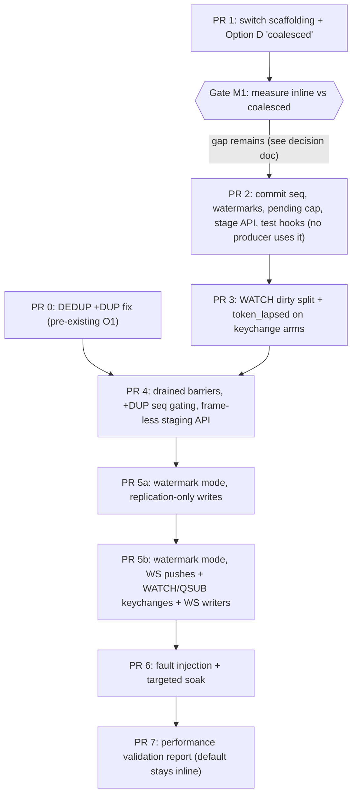

# v0.6.0 Phase 6N-B: future implementation plan

**Status:** a plan only. **No PR below is authorized by Phase 6N-B.** Each needs maintainer approval.
**Base:** `dev` `a90e08d`.
**Design:** [`V0.6N-B-WATERMARK-DESIGN.md`](V0.6N-B-WATERMARK-DESIGN.md).

The brief's suggested six PRs are refined here, for three reasons:
- the ordering fixes (WATCH dirtiness, drained cuts, `+DUP` gating) must exist **before** any effect is delivered late, so they move ahead of the gating PRs;
- a low-risk Option D step and a pre-existing DEDUP fix come first;
- replication gating is split from WS/watcher gating, because the 6N-1 workload needs only the former.

## Dependency graph

**Rules for every PR:**
- In `inline` mode (the default) it must be behaviour-neutral. The proof is the existing suite unchanged plus its own tests.
- The `recached-server` suite and the subprocess fail-stop harness (`tests/aof_fail_stop.rs`) must pass in **every** mode once the mode exists. CI runs the server test job a second time with `RECACHED_AOF_FANOUT=watermark` from PR 5a on.
- No protocol, file-format, SDK or default change.
- An independent review of each PR from PR 2 on. PRs 4, 5a and 5b need a reviewer who also checks the invariants document.

---

### PRs 0b–0e — other pre-existing fixes found by the review (independent of 6N-B, any order)

| PR | Finding | Change | Deterministic test |
|---|---|---|---|
| 0b | RV-6: WS scope/admin DEDUP refusal takes every stripe | Stop taking every stripe. The refusal must still not split across a checkpoint (the reason the code's comment gives for the barrier), but `save` takes `save_lock` and then the all-write barrier, not `dedup_order`. So the PR introduces a lock both sides share, e.g. `save` also taking `dedup_order`, or the refusal taking `save_lock` shared. Also rate-limit refusals per connection | `DEDUP c n FLUSHDB` refused while a writer on an unrelated key proceeds (no barrier wait) |
| 0c | RV-8: QSUB `qstate` can contain a deferred TCP write before its `write(2)` | After the cut, record the AOF queue tail and wait for it to settle (stripes released) before sending `qstate` | Hook pauses the leader; `qstate` waits |
| 0d | RV-7: replica-side DEDUP records applied without stripes or `still_following` | Hold a real stripe, `lock_commands_and_keys(&[], once(client))`, plus `still_following` around them (round 2 NEW-3: `lock_commands(&[])` takes no stripe) | Sub-replica attach races a mark-only record; promotion then refuses it |
| 0e | RV-12: unauthenticated WS sockets disable the unordered fast path | Count a push receiver only once routed (authenticated) | Unauthenticated socket: writes stay on the unordered path |

Also in PR 3 for all modes: the RV-2 dequeue checks on the keychange arms (the window exists today).

### PR 0 (0a) — `+DUP` must not precede the original write's AOF stage (pre-existing)

**Problem (O1):**
- On the deferred TCP path, a DEDUP write commits its mark before its batch is written.
- A replay on another socket is answered `+DUP` at once.
- Under `always`, a failure of that batch then loses an acknowledged write.

**Change:**
- DEDUP-wrapped writes and DEDUP outcomes never defer: `may_defer && dedup.is_none()` in `on_write_logged`. Every mark is then committed after its frame's AOF stage, which also covers the WS early-replay path (RV-9).
- `record_dedup_refusal` logs before it remembers (RV-9).
- Under the watermark design (PR 4), "never defer" is replaced by seq gating.

**Cost:** TCP DEDUP writes lose cross-connection coalescing. Today's sync SDKs write DEDUP over WebSocket, which never defers anyway.

**Tests:**
- Deterministic: a `cfg(test)` hook pauses the leader before `perform`. Connection 1 sends `DEDUP c 1 INCR k`, connection 2 sends the same. Assert that no `+DUP` byte arrives while the leader is paused.
- Subprocess: `always` + `fsync:eio` keyed on the frame, with a second client replaying. Assert the restart has the write if, and only if, a reply of any kind was seen.

**Mutation:** revert the condition → the deterministic test fails.

**Rollback:** revert the PR.

**Size:** S.

### PR 1 — Mode switch and Option D (`coalesced`)

**Change:**
- `RECACHED_AOF_FANOUT=inline|coalesced` (later also `watermark`), parsed like `RECACHED_AOF_COALESCE`, with an `INFO` field.
- `AofWriter::append_coalesced`: queue, one `Coalescer` yield, lead, wait.
- `on_write_logged` uses it when the mode is `coalesced` and the call would otherwise be inline.

**Tests:**
- 50 ready connections with replication enabled share ≤ 3 writes in `coalesced` and need 50 in `inline`. This mirrors the existing `gate_tests` test.
- Fan-out order for conflicting writes.
- Every existing replication/WS/WATCH test, parameterized over the two modes.

**Mutation:** a yield that does not wait; a lead before the yield.

**Gate M1:** run the primary workload of the [validation plan](V0.6N-B-VALIDATION-PLAN.md) (§3) for `inline` vs `coalesced`. The [design decision](V0.6N-B-DESIGN-DECISION.md) states the threshold for continuing to PR 2.

**Rollback:** `inline`.

**Size:** S–M.

### PR 2 — Commit seq, watermarks, pending accounting, `stage` API

**Change (`persistence.rs` only, plus `INFO`):**
- `next_seq`, `first_seq`/`last_seq` per batch;
- the `settled`/`durable`/`released` watermarks and `gap_from` (design §4);
- `Pending` charge and cap (N10);
- `stage()`, `stage_effect_only()`, `wait_released()`, `quiesce()`;
- `StagedEffect` with a no-op release (no producer stages yet);
- under `always` only: `flush`'s fsync performed as a zero-frame `needs_disk` batch holding the writer role (RV-11; under `everysec`/`no` it stays outside `busy`);
- the bound on batches per inline `lead()` (RV-13), with **re-leading waiters**: `gate_wait`, the WS gate and `wait_released` loop register → check → lead → await on `advanced`, and a bounded leader that returns with work left both notifies waiters and **spawns a continuation** (round 2 NEW-2, round 3 R3-2). Second test: mass disconnect of 50 connections holding ESET keys under `no` with no other traffic; every ephemeral DEL reaches the AOF. Test: under `no`, 20 batches queued with `LEAD_BATCHES_MAX = 8`, no further traffic; every gate completes;
- the WS task-local ticket high-water mark and the ticket-registration rule for every stage site (RV-1, RV-3), unused until PR 5a;
- `cfg(test)` hooks: `PauseAfterStage(seq)`, `PauseBeforeRelease(batch)`, `DelayWrite(ms)`.

**Tests:**
- Seq contiguity across truncate and flush batches.
- Watermark monotonicity under `AofFault` sequences.
- `durable` frozen after an `everysec` failure until a checkpoint.
- `released ≤ settled` always; under `always`, `released ≤ durable`.
- `wait_released` wakes on release and returns `Err` after `stopped` (Latch).
- `quiesce` returns only when `released == issued` at call time.
- Pending cap triggers `over_cap`.

**Mutation:**
- advancing `settled` before `settle`;
- advancing `durable` across `gap_from`;
- `wait_released` not checking `stopped`.

**Rollback:** unused API; revert.

**Size:** M.

### PR 3 — WATCH invalidation separated from delivery; keychange arms check token expiry

**Change:**
- `WatchSubscriber.dirty` (WATCH only) and `wants_payload` (false on TCP).
- `mark_dirty` in the watcher fan-out, under `registry.map`.
- EXEC (TCP and WS) reads the flag after taking its stripes.
- The flag is reset after `unregister_all_watches`.
- The `watch_rx` arms stop setting `watch_dirty`.
- `token_lapsed`, the current-scope check, the held-subscription check and the registration-age check (a covering registration of the same kind exists and none is newer than the stamp; sentinels matched exactly; no bump on `SYNC TOKEN`; QSUB of a held pattern re-registers) are all checked on the `watch_rx`/`q_rx` arms, in every mode (design §11, RV-2, round 2 NEW-1). Tests: token renewal with an in-flight keychange delivers it; `QUNSUB P1` with `P2` held delivers; partial `UNWATCH` delivers for the remaining keys; a re-subscription drops it; a new overlapping pattern drops it (delta not applied twice); a stale FLUSHDB sentinel does not match through `*`.
- Delivery is still inline in this PR, so the change is observable only through tests.

**Tests:**
- **Deterministic S3:** WATCH k; a writer that takes the stripe, marks and then pauses (hook) before delivery; EXEC must abort. With delivery inline the same test passes trivially, so it is also run against a test build that suppresses delivery, to prove the flag alone suffices.
- A late keychange does not dirty the next transaction.
- TCP WATCH sends nothing and prepares no payload.
- Token expiry stops a queued keychange.

**Mutation:**
- EXEC ignoring the flag (S3 test fails);
- resetting the flag before unregistering (a race test with the hook);
- the arm still setting `watch_dirty`.

**Rollback:** revert. Behaviour in `inline` is identical.

**Size:** M.

### PR 4 — Drained barriers, `+DUP` seq gating, frame-less staging

**Change:**
- `lock_all_writes_drained` used by `handle_replica` (full and partial), `promote_to_primary` and `save`. QSUB uses the cut-then-wait form, outside the stripes (RV-5, building on PR 0c).
- The replica apply path is pinned to `on_write_logged_inline` and `log_dedup_outcome_inline` (RV-4).
- `DedupMark.seq`, and `wait_released(mark.seq)` before every replay answer. This replaces PR 0's "never defer" in watermark mode only.
- `capture_removed` and `stage_effect_only` for active expiry and keyspace-wide notifications.
- All of these are no-ops while nothing is staged.

**Tests:**
- **Deterministic S5:** stage an `INCR` (hook pauses before the performer), attach a replica, release. The replica must equal the primary. The test is run with the drain removed to show it fails.
- QSUB analogue: `qstate` never contains an unreleased write.
- `+DUP` waits: pause before release, replay on another socket, and no `+DUP` until release.
- Expiry ordering: a staged `SET k v EX` keychange is not overtaken by the expiry's removal notice.

**Mutation:**
- the drain removed (S5 and QSUB tests);
- `+DUP` not waiting;
- expiry delivered directly.

**Rollback:** revert. No effect in `inline`.

**Size:** M.

### PR 5a — Watermark mode for replication-only writes

**Change:**
- `RECACHED_AOF_FANOUT=watermark` accepted.
- In this mode, a write whose **only** observers are the AOF and the replication stream (no WS route candidate, no watcher, no live query) stages its frame plus its `repl` effect.
- `log_dedup_outcome` stages too.
- The performer releases through `ReplHub::fan_out_batch`.
- Writes with any other observer stay inline. This is exactly the 6N-1 replicated workload.

**Tests:**
- Same-key order (S1) in the AOF and in replica offsets, under random scheduling with fixed seeds.
- The replica never receives an unwritten frame: a `PauseBeforeRelease` hook plus an in-process replica (`attach_test_replica`) reading at every step.
- Partial and full resync while batches are pending.
- `always` fail-stop with replication: subprocess. The existing `always_failure_with_replication_enabled_stops_without_acknowledging` passes in watermark mode, plus a variant asserting that the replica received **no** frame of the failed batch.
- Slow replica disconnect.
- Pending cap reached: memory bounded, no deadlock.
- Promotion (6L R2 tests) in watermark mode.

**Mutation:**
- release before `settle`;
- release without the `stopped` check;
- release outside `busy` (order test);
- `done.complete` before release (reply-before-replica test).

**Rollback:** `inline`.

**Size:** M–L.

### PR 5b — Watermark mode for WS pushes, WATCH/QSUB keychanges and WS writers

**Change:**
- Capture splits into `prepare` + staged `deliver`; `SyncPush` is staged.
- WS writes stage and await `done` after one coalescing yield, with the lead done before the await.
- The "replication-only" restriction from PR 5a is removed.

**Tests:**
- WS push never precedes the AOF write: a probe socket reads the AOF on every received push.
- QSUB snapshot + registration under pending writes.
- Scope narrowing with queued pushes and keychanges (S8), revoking and non-revoking.
- Token expiry with a queued keychange.
- WS writer disconnect mid-await (S9).
- Mailbox gap under pending batches.
- Delta subscribers receive per-write deltas in order (S1 with `CLIENT DELTA ON`).
- Cross-tenant: a write staged under tenant A's key is never forwarded to a tenant B socket in any interleaving the hooks can produce.

**Mutation:**
- payload re-read at release (S1 delta test);
- `forwards_push` skipped for staged pushes;
- the token check removed.

**Rollback:** `inline`.

**Size:** L.

### PR 6 — Fault injection and production validation

**Change:** no production change. Extends the subprocess harness and the 6L soak kit with a `RECACHED_AOF_FANOUT` dimension.

**Runs:** the validation plan §2 (fault matrix) and §5 (targeted soak, watermark mode only).

**Size:** M.

### PR 7 — Performance validation report

**Change:** `benchmarks/v0.6.0/6n-c/` (or the next phase's directory), with measurements per the validation plan §3–4. **The default stays `inline`.** Changing it is a separate maintainer decision, taken after this report and the soak.

**Size:** S (report) + host time.

---

## Rollback strategy (overall)

| Level | Action |
|---|---|
| Runtime | `RECACHED_AOF_FANOUT=inline`. Every PR keeps that path byte-for-byte as today, except PR 0 (a fix) and PR 3 (which moves the dirty signal; equivalent) |
| Release | Ship with the default `inline`. `watermark` is documented as experimental until PR 7 and its soak pass |
| Code | PRs 5a/5b are the only PRs whose code runs exclusively in `watermark` mode. Reverting them leaves PRs 2–4 inert |

## Effort and sequencing estimate

| PRs | Estimate |
|---|---|
| PR 0 + PR 1 + gate M1 | About 1 week including the measurement |
| PR 2–5b | About 3–4 weeks of implementation and review |
| PR 6 | About 1 week |
| PR 7 | Host time plus a report |

These estimates assume one engineer and include independent reviews.
