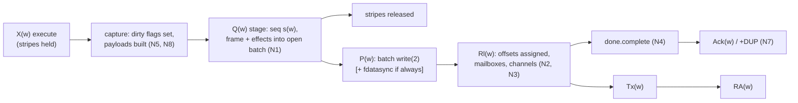

# v0.6.0 Phase 6N-B: ordering invariants

**Source:** `dev` `a90e08d`.

**Why G1–G10 are reconstructed.** The brief names "the Phase 6M replication/persistence review's G1–G10" as the baseline. That review document is not in the repository (see [current architecture §1](V0.6N-B-CURRENT-ARCHITECTURE.md#1-baseline-evidence-reused)).

G1–G10 below are therefore **reconstructed** from:
- the code's own stated guarantees;
- PRs #121–#125;
- `docs/server/configuration.md` and `docs/server/protocol.md`.

Each cites where it is stated or enforced. If the original list surfaces, it should be reconciled with this one before implementation (design-decision condition C5).

## Terms: events kept distinct

| Event | Symbol | Meaning |
|---|---|---|
| Executed | `X(w)` | The store holds the mutation; any read can see it |
| Staged | `Q(w)` | The AOF frame is in an open batch with its file position fixed. Under the watermark design it also has a commit seq `s(w)` |
| Written | `Wr(w)` | `write(2)` of its batch returned successfully |
| Synced | `Sy(w)` | An `fdatasync` covering it returned successfully |
| Settled | `St(w)` | Its batch's outcome is known: success, or a reported non-fatal failure (`everysec`/`no`) |
| Released | `Rl(w)` | Its observer effects were handed to the replication stream, mailboxes and notification channels |
| Transmitted | `Tx(w)` | A replica sender or WS socket wrote it out |
| Replica-acked | `RA(w)` | A replica reported the offset applied. Never awaited by clients |
| Acknowledged | `Ack(w)` | The first byte of its normal reply (or of a `+DUP` for it) leaves for the socket |
| Snapshot-visible | `Sn(w)` | Included in a full-sync snapshot, a QSUB `qstate`, or a SAVE snapshot |

`→` is happens-before. The **required stage** `P(w)`, unchanged by this design:

| Policy | `P(w)` |
|---|---|
| `always` | `Sy(w)` |
| `everysec` / `no` | `St(w)`. Today this is "the inline `append` returned", success or non-fatal failure; see G3 |

## Baseline guarantees (reconstructed G1–G10)

| # | Guarantee | Stated / enforced |
|---|---|---|
| **G1** | **Acknowledgment after the AOF stage.** `P(w) → Ack(w)`, and on a connection, `P(w') → Ack(w)` for every earlier `w'` on that connection. Under `always` a normal reply implies the frame was fdatasynced | `AofGatedWriter` doc (`persistence.rs:1078`); #121 "What did not change"; `configuration.md:223` |
| **G2** | **Conflicting writes keep store order** in the AOF, replication offsets, watcher notifications and WS pushes | `execute_ordered_write` doc (`propagation.rs:361`); `AofWriter` doc (`persistence.rs:234`); `ReplHub.write_order` |
| **G3** | **No observer before the AOF stage.** For every replica frame, keychange, QSUB keychange and WS push: `St(w) → Rl(w)` (and `Sy(w) → Rl(w)` under `always`). Under `everysec`/`no` a non-fatal failure still releases: memory holds the write and later writes get MISCONF | `on_write_logged` doc (`server_state.rs:626`); `apply_repl_frame` "logged first, then announced"; `configuration.md:95` |
| **G4** | **Replication offsets are contiguous and monotonic.** A frame reaches the backlog and every replica queue before the next offset is assigned. Partial resync serves only fully retained ranges. **Promotion:** every replicated frame is applied as a follower's before `REPLICAOF NO ONE`, or refused after it (6L R2) | `fan_out` (`replication.rs:333`); `resume_frames`; `promote_to_primary` (`server_state.rs:447`) |
| **G5** | **Consistent cuts.** Full sync, QSUB initial state, SAVE and active expiry run under the all-write barrier. The snapshot and the offset (or registration) describe one instant, and the DEDUP table is captured at the same instant | `handle_replica` (`replication.rs:994`); QSUB (`connection.rs:1991`); `save` (`server_state.rs:829`) |
| **G6** | **WATCH/EXEC.** A write to a watched key that committed before EXEC's check marks the transaction dirty, and EXEC aborts. No conflicting write can enter between the check and execution | EXEC (`connection.rs:640–657`); `lock_commands_and_keys` doc |
| **G7** | **DEDUP atomicity.** Mutation and identity are one AOF frame (envelope) and one replication frame. The mark is committed in memory only after a successful execute, under `dedup_order` and the stripes. Permanent refusals are durable. A retry after a crash applies at most once when its outcome is recoverable | `on_write_identified` doc; `protocol.md:247`; `commit_dedup_outcome` |
| **G8** | **`always` fail-stop.** After a failed `always` write or fsync, no reply, replica frame, keychange or push for that batch or any later one is emitted; the process exits 74 | `fail_stop` (`persistence.rs:655`); #125; `configuration.md:95` |
| **G9** | **Torn-write repair.** The file ends on a whole frame; frames that landed whole are kept; nothing is appended after an unrepaired fragment | `cut_back`, `remove_torn_fragment`; #123 |
| **G10** | **Bounded, never blocked by a consumer.** These are bounded: replica queues (4096 frames / 8 MiB; overflow disconnects for resync), WS mailboxes (capacity / 16 MiB; overflow closes with sync-gap), notification queues (256 / 8 MiB; overflow disconnects). A writer never waits on a consumer. AOF memory is bounded by callers waiting on their batch | `ReplHub::fan_out`; `sync_router.rs` header; `watch.rs:8`; `AofWriter` doc (`persistence.rs:253`) |

### Known weak points in the baseline

These are not regressions; they are carried into the review.

| Ref | Weak point | Affects |
|---|---|---|
| O1 | A `+DUP` replay is not gated on the original write's AOF stage | G1/G7 on the deferred TCP path, today |
| O2 | Reads, EXEC results and EXEC aborts can reflect a write before `P(w)`. G1 covers only a write's own reply | — |
| O3 | Active expiry has no AOF or replication frame | — |
| G10 | A deferring TCP connection can queue up to its 64 MiB read buffer of frames before its gate waits, with no global cap | `config.rs:26` |
| G5 (review RV-8) | Does not hold for deferred writes: a QSUB `qstate` (or a full sync) can contain a deferred TCP write before its `write(2)` | — |
| G2/N11 (review RV-2) | QUNSUB does not drain `q_rx`, and the `q_rx` arm forwards without a scope check, so a keychange can arrive after its subscription ended | — |
| G4/G5/G7 (review RV-7) | Replica-side DEDUP records are applied without stripes or `still_following` | — |

## Brief invariants A–H, mapped and extended

| Brief | Baseline | Required of the new design |
|---|---|---|
| **A** AOF ordering | G2 | Conflicting writes get commit seqs in store order. The file order is seq order. Batching never reorders seqs |
| **B** AOF-before-observer | G3, G5 | `P(w) → Rl(w)` for every effect. **And** no snapshot (full sync, QSUB) may contain a write with `Rl(w)` not yet reached (N6) |
| **C** Acknowledgment | G1, G8 | `P(w) → Rl(w) → Ack(w)`, including a `+DUP` for `w` from any connection (N7). Fail-stop releases nothing at or after the failed batch (N9) |
| **D** WATCH/MULTI/EXEC | G6 | **Invalidation at capture, under the writer's stripes; external delivery at release** (N5). An EXEC that takes the stripe after a conflicting writer released it sees the dirty flag even though the keychange is still staged |
| **E** DEDUP | G7 | Mark committed under the stripes as now, but tagged with `s(w)`. A `+DUP` for it waits for `P(w)` (N7). The envelope stays one frame in the AOF and the replication stream |
| **F** Replication | G4, G5 | Offsets are assigned at release, in seq order (N2). Full sync **drains** before its cut (N6). Partial sync, backlog retention and promotion are unchanged |
| **G** Real-time sync | G5, G10, `forwards_push` | Pushes and keychanges are delivered after release. **Authorization is decided at delivery (dequeue) time**, as today (N11). QSUB cut drains first (N6) |
| **H** Bounded resources | G10 | A global pending cap with an inline fallback (N10). Every staged item is charged against an existing per-consumer budget at capture. No task per mutation; release never blocks |

## New invariants for watermark-gated fan-out

| # | Invariant | Why it is needed |
|---|---|---|
| **N1** | Commit seqs are assigned under the AOF queue lock. They are contiguous and strictly increasing per process, never persisted and never on the wire | Gives the release order without new protocol state. Restart/truncation questions disappear (see the design §3) |
| **N2** | **Release in seq order.** Effects are released by the batch's performer, before it gives up the exclusive writer role. Batch `k`'s effects are therefore all released before batch `k+1` is performed. Replication offset order = AOF order | G2 for observers once the stripe is no longer held across the write |
| **N3** | **Release only after the required stage.** `P(w) → Rl(w)` | G3 |
| **N4** | **Completion after release.** A batch's `AofDone` completes only after its effects are released, so every reply gate (and every waiter on `done`) observes `Rl → Ack` | Model property P1: keying the reply on the written watermark lets a reply precede the replica frame |
| **N5** | **WATCH dirtiness is set at capture**, synchronously under the writer's stripes, on a per-subscriber flag EXEC reads after taking its stripes. Only the keychange *payload* is staged | Model property P3: with the dirty signal riding on the staged keychange, EXEC commits on a stale read |
| **N6** | **Drained cuts.** A barrier that chooses a replication offset (full or partial sync, promotion, SAVE) takes the all-write barrier and then waits until `released ≥ issued`. With the stripes held, `issued` cannot grow, and release needs no stripe. **QSUB** instead records `I = issued` under the barrier, drops the stripes, and waits for `released ≥ I` before sending `qstate` (review RV-5), so a client cannot stall every writer once per fsync | Model properties P2/P4: without it a staged write is in the snapshot **and** streamed again (an `INCR` applied twice on the replica), and the snapshot exposes a write before its AOF stage |
| **N7** | **Gated `+DUP`.** A DEDUP mark records the commit seq of the write that set it. A replay answered from the mark waits until `P(that seq)` before replying | O1; Invariant C/E |
| **N8** | **Capture under the stripes, payload fixed at capture.** Values, deltas, expiry deadlines, push keys and subscriber sets are computed while the writer holds its stripes, exactly as today. Release only delivers | Re-reading at release would reorder per-key values |
| **N9** | **No release after a stop.** A batch that fails under `always` is never released, nor any later one. The release step checks `stopped` before handing anything over | G8 |
| **N10** | **Bounded pending state.** Staged bytes plus effect charges are capped globally. A writer that would exceed the cap waits for its own batch inline under its stripes, which is today's behaviour, so the cap degrades throughput and never correctness | Invariant H |
| **N11** | **Authorization at delivery, for pushes and keychanges alike.** A staged push or keychange carries no authorization decision. At dequeue the receiving connection checks:<br>• current scopes;<br>• token expiry;<br>• for keychanges, that a registration still held and older than the capture covers the key. Token renewal does not invalidate it.<br>Revocation still closes the connection. *Revised after review RV-2: the draft relied on "authorized at subscription time" for keychanges, which a QUNSUB followed by a non-revoking narrowing defeats* | Invariant G, Scenario 8 |
| **N13** | **Every reply waits for every ticket its command staged.** This covers writes, EXEC, DEDUP/scope refusals and any other reply on any transport. TCP: tickets go to the connection's gate. WS: a task-local high-water seq is awaited before each reply. A stage with no connection in scope leads after dropping its guards. *Added after review RV-1/RV-3* | Invariant C. The draft gated only "write commands", which missed WS EXEC and refusals |
| **N12** | **Frame-less observer effects ride the queue.** Notifications without an AOF frame (active expiry, FLUSHDB sentinels, keyspace replacement) are staged behind the current tail (ticket = last issued seq). They are never delivered directly, so they cannot overtake a staged keychange for the same key | O3: an expiry "removed" delivered before an earlier staged SET keychange would resurrect the key in the client's copy |

## Happens-before

### H1 — One write, watermark design



### H2 — Conflicting writes `w1`, `w2` on key `k`

```text
w1: lock(k) → X(w1) → capture → Q(w1)=s1 → unlock(k)
                                              │ (mutex hand-off)
w2:                                           lock(k) → X(w2) → capture → Q(w2)=s2 → unlock(k)
leader: …perform batch∋s1 → Rl(s1) → … perform batch∋s2 → Rl(s2)     (s1 < s2, N2)
```

`unlock(k)` by `w1` happens before `lock(k)` by `w2`, so `s1 < s2` (N1). Every observer queue is FIFO and fed in seq order (N2), so each sees `w1` before `w2`.

### H3 — WATCH vs EXEC (Scenario 3)

```text
B: WATCH k → GET k (v0) → MULTI → SET k v'
A: lock(k) → X(A) → dirty[B] := true (N5) → Q(A) → unlock(k)
B: EXEC → lock(k ∪ queued) → read dirty[B] = true → abort (nil)
```

`unlock(k)` by A happens before `lock(k)` by B, so B reads `dirty = true`. If B locks first, A's `X` happens after B's commit, and B commits on a current read.

### H4 — Full sync during pending batches (Scenario 5)

```text
F: lock_all_writes → issued := I → wait(released ≥ I) (N6) → snapshot + offset O + dedup table → register → unlock
```

Every `w` with `s(w) ≤ I` has `Rl(w)` before the snapshot, so its replication frame has offset `≤ O`; it is in the snapshot and is not streamed. Every later `w` executes after `unlock`, gets `s > I`, is released after registration, and is streamed with offset `> O`.

## Machine-checked subset

[`model/ordering_model.py`](model/ordering_model.py) explores every interleaving of two `INCR k` writers, the AOF leader, one WATCH+EXEC and one full sync. It checks:

- P1 ack ⇒ released;
- P2 visible ⇒ written;
- P3 WATCH/EXEC;
- P4 replica convergence.

| Variant | States | Violated | Shows |
|---|---:|---|---|
| inline (today) | 322 | none | The baseline holds |
| naive (stage, drop the stripe) | 2890 | P1, P2, P3, P4 | Deferral alone is unsafe |
| + N5 only | 2002 | P1, P2, P4 | |
| + N6 only | 1642 | P1, P3 | |
| + N5 + N6 | 1204 | P1 | N4 is needed too |
| + N4 + N5 + N6 ("fixed") | 916 | **none** | |

Output: [`model/ordering_model.out`](model/ordering_model.out).

**What the model does not check:**
- multiple keys;
- failures (those are in the [failure-mode analysis](V0.6N-B-FAILURE-MODE-ANALYSIS.md));
- authorization;
- DEDUP;
- memory bounds.

It is a design aid. It is not a proof of the Rust implementation.
