# v0.6.0 Phase 6N-B: watermark-gated fan-out, preferred design

**Status:** design only. Nothing here is implemented, and implementation needs maintainer approval.
**Source:** `dev` `a90e08d`.
**Selected architecture:** Option A, the ordered commit batch ([alternatives](V0.6N-B-ALTERNATIVES.md)).
**Invariants:** [G1–G10, N1–N12](V0.6N-B-ORDERING-INVARIANTS.md).

Changes made after the independent review are marked **[R]** and cross-referenced to [`V0.6N-B-INDEPENDENT-SECURITY-REVIEW.md`](V0.6N-B-INDEPENDENT-SECURITY-REVIEW.md).

## 1. Summary

A write that some observer will see today appends its AOF frame **inline**, while holding its write-order stripes:
1. it leads its own one-frame batch;
2. it waits for the `write(2)`;
3. it fans out;
4. it releases the stripes.

That costs one `write(2)` per command (6N-1: 1.00 writes per command, 0.45× standalone).

Under this design the writer instead:
1. **captures** its effects while holding the stripes (payloads built, WATCH dirty flags set);
2. **stages** frame and effects together into the open AOF batch with a commit seq;
3. drops the stripes.

The batch's **performer**, which already holds the exclusive writer role:
1. writes (and, under `always`, fdatasyncs) the batch;
2. **releases** its effects in seq order: replication offsets, mailboxes, notification channels;
3. **then** completes the batch.

Reply gates wait on that completion. Barriers that cut a snapshot **drain** first, and `+DUP` replies wait for the original write's release.

## 2. Mode switch (proposed configuration, not an existing option)

| `RECACHED_AOF_FANOUT` | Behaviour |
|---|---|
| `inline` (default) | Today's code path, unchanged |
| `coalesced` | Option D: inline, but the append yields once before leading. Same effects, same order |
| `watermark` | This design |

Read once at startup and logged. Invalid values are a startup error (same style as `RECACHED_AOF_COALESCE`). Without an AOF the switch has no effect: there is nothing to wait for, and fan-out stays direct.

## 3. The commit identifier

**Choice:** a process-local `u64` **commit seq**, one per staged frame, assigned under the AOF queue lock. It is contiguous from 1 for the life of the `AofShared` (one per process), never written to disk and never sent on the wire.

| Candidate | Rejected because |
|---|---|
| AOF byte offset | Checkpoints truncate the file to 0. A torn-write cut-back moves the end. Outside truncation and appends are tolerated by design (`cut_back` reads `fstat`). An offset is therefore not monotonic across those events |
| Batch id | Effects need an order **within** a batch. "Batch id + index" is equivalent to a seq, with more state |
| Commit ticket object (`Arc`) | One allocation per write. The existing per-batch `Arc<AofDone>` already gives waiters a handle |
| Composite (generation, seq) | The generation exists only to survive restart, truncation or rotation. A seq that is never persisted or transmitted has none of those to survive |
| Replication offset | Only assigned when replication is enabled, and assigned at release, which is too late to order staging |

**How the seq handles the events the brief lists:**

| Event | Handling |
|---|---|
| Truncation (checkpoint) | A truncate is a batch with zero frames. Seqs are unaffected. `SAVE` drains first (§9), so no effect is pending across it |
| AOF checkpoint marker | An inline `append` (no effects). It gets a seq like any frame |
| Log rotation | Not applicable: there is no AOF rewrite or rotation in the codebase. Only checkpoint truncation exists |
| Restart | The process restarts with seq 1. The replication `run_id` changes on restart, so replicas full-sync as today. Nothing compares seqs across processes |
| Replica full sync | Uses its replication offset, chosen under a drained barrier (§9) |
| Rollover | `u64`. At 10⁷ writes/s it lasts about 58,000 years. `checked_add` with fail-stop on overflow, to be explicit |
| Partial write | A batch is the unit of outcome; whole-frame retention is unchanged (§10) |
| Failed batch | See the watermarks below and §10 |

## 4. Watermarks

All four live in `AofShared`. Each is an `AtomicU64`, written only by the current performer, or by `flush` for `durable`.

| Watermark | Meaning | Advances when | Never advances past |
|---|---|---|---|
| `issued` | Highest seq staged (`next_seq − 1`) | `stage()`, under the queue lock | — |
| `settled` | Every seq `≤ settled` belongs to a batch whose outcome is known | The performer, after `settle` returns, and only if `!stopped` | A batch that failed under `always` (the process exits; in tests, `stopped` freezes it) |
| `durable` | Every seq `≤ durable` was written **and** covered by a successful `fdatasync` | `always`: with `settled`, on success. `everysec`/`no`: `flush` advances it to the seq sealed by its anchor batch **only if no batch failed since the last checkpoint** (`gap_from == NONE`). A checkpoint re-bases it | The first seq of a failed batch, until a checkpoint truncates the file |
| `released` | Every seq `≤ released` had its effects handed to their sinks | The performer, after releasing the batch | `settled`. Under `always`, `durable` |

**Release predicate (N3):**
- `always`: the batch performed **and fdatasynced** successfully;
- `everysec`/`no`: the batch **settled**, successfully or with a non-fatal error.

The second rule deliberately reproduces today's inline semantics (G3). After a non-fatal failure, memory already holds the write, later writes get MISCONF, and withholding the effects would only make replicas and browsers diverge from a primary that keeps serving the write. A resync would hand them the same state anyway. Decision D2 in the [design decision](V0.6N-B-DESIGN-DECISION.md) asks the maintainer to confirm this rule.

**There is no separate release-relevant "written" watermark.** Under `always`, `settled = durable`. Under the other policies, the release criterion is `settled` by contract. A "written" watermark that skips failed batches would be misleading, because after a failure the file is not a prefix of the seq space. `recached_aof_written_seq` is still exported for diagnostics, frozen at the first failure.

**Every client-visible wait uses one predicate: `released ≥ s`.** That covers the reply gate (through `done`), `+DUP` and drained barriers. Release implies `P(w)` (N3), and completion follows release (N4).

## 5. Data structures

```rust
// persistence.rs (sketch; names indicative)

struct AofQueue {
    batches: VecDeque<AofBatch>,
    busy: bool,
    next_seq: u64,                 // N1
    pending: Pending,              // N10
}

struct Pending { bytes: usize, frames: usize }

struct AofBatch {
    bytes: Vec<u8>,
    frames: u64,
    first_seq: u64, last_seq: u64, // contiguous; last_seq == first_seq-1 when empty
    opened: Option<Instant>,
    truncate: bool,
    sealed: bool,
    effects: Vec<StagedEffect>,    // seq order; empty unless watermark mode
    charge: Pending,               // what this batch adds to AofQueue.pending
    done: Arc<AofDone>,
}

/// Everything a write makes observable, captured under its stripes.
pub(crate) struct StagedEffect {
    seq: u64,                                     // 0 for frame-less (N12)
    repl: Option<Arc<Vec<u8>>>,                   // envelope or bare, per streams_dedup
    push: Option<Arc<SyncPush>>,                  // WS candidate push
    notes: SmallVec<[PreparedNotif; 1]>,          // WATCH (WS only) + QSUB keychanges
}

/// A keychange whose budget is already reserved (watch.rs).
pub(crate) struct PreparedNotif { sub: WatchSubscriber, notif: WatchNotif }

/// Where released effects go. Set once at startup (OnceLock), so AofShared
/// holds no reference back to ServerState.
pub(crate) struct EffectSink { hub: ReplRegistry, sync: SyncTx }

struct Watermarks {
    settled: AtomicU64, durable: AtomicU64, released: AtomicU64,
    gap_from: AtomicU64,           // first seq of a failed batch since checkpoint, or NONE
    advanced: tokio::sync::Notify, // notify_waiters() after `released` moves
}
```

```rust
// watch.rs
pub(crate) struct WatchSubscriber {
    /* existing fields */
    /// WATCH subscribers only: set at capture (N5). Shared with the
    /// connection's transaction state; EXEC reads it after taking stripes.
    dirty: Option<Arc<AtomicBool>>,
    /// False for TCP WATCH (pure CAS, no keychange is ever sent): nothing
    /// is prepared or staged for it.
    wants_payload: bool,
}
impl WatchSubscriber {
    fn mark_dirty(&self);                                     // Release store
    fn prepare(&self, change: &KeyChange<'_>) -> Option<PreparedNotif>; // budget reserved; None = overflowed (signalled)
    fn deliver(p: PreparedNotif) -> bool;                     // try_send; false = overflow (signalled)
}
```

```rust
// replication.rs
impl ReplHub {
    /// One stream-lock acquisition for a whole batch; offsets contiguous,
    /// in the order given. Same per-replica drop rules as fan_out.
    pub(crate) fn fan_out_batch<'a>(&self, frames: impl Iterator<Item = &'a Arc<Vec<u8>>>);
    /// lock_all_writes, then `aof.quiesce()` (N6).
    pub(crate) async fn lock_all_writes_drained(&self, aof: Option<&AofWriter>) -> io::Result<OrderGuards<'_>>;
}
```

## 6. API boundaries

| API | Caller | Contract |
|---|---|---|
| `AofWriter::stage(frame, effect) -> Staged { seq, done, over_cap }` | `on_write_logged`, `log_dedup_outcome` (watermark mode, primary paths) | One queue lock. Assigns a seq, appends bytes and the effect, charges `pending`. `stage` itself never leads. The caller holds its stripes but **no registry lock**: capture drops `registry.map`/`patterns` before staging **[R] RV-13** |
| `AofWriter::stage_effect_only(effect) -> Staged` | Active expiry, keyspace-wide notifications (N12) | Seq 0. Rides behind the current tail |
| **Ticket registration [R] RV-1, RV-3** | Every `stage`/`stage_effect_only` call site | The returned ticket is **always** registered with whoever owns the reply. **Inside a TCP connection**: pushed to the connection's `AOF_DEFERRED` tickets (as `append_client_write` does today), so the gate waits for it before *any* socket byte. **Inside a WS connection**: a task-local `WsTickets { high: seq }` (the same `task_local!` pattern as `AOF_DEFERRED`); `handle_ws` awaits `wait_released(high)` before **every** reply it sends, whether the reply comes from a write, EXEC, a DEDUP/scope refusal or anything else. **Outside any connection** (expiry sweeper, eviction sweeper, ephemeral release after the connection's scope ended, replication handler): the caller **leads after dropping its guards** and does not wait |
| `Staged::over_cap` | Writer | If true, the writer **leads and awaits `done` before dropping its stripes** (N10) |
| `AofWriter::wait_released(seq)` | `+DUP`/refusal replay, QSUB, `quiesce`, the WS reply gate | Loop: register on `advanced`, check `released ≥ seq`, `lead()`, await. `Err` if `stopped` |
| `AofWriter::quiesce()` | `lock_all_writes_drained` | `issued` read under the queue lock; `wait_released(issued)` |
| `AofGatedWriter` | TCP, unchanged | Waits on `done`, which now completes after release |
| WS write | `handle_ws` | `lead()` **first** (so a dropped command future has already led), then one coalescing yield (shared `Coalescer`), then the reply gate above **[R] RV-3**. A WS connection has one command in flight, so this is the same as today's inline wait, minus the solo batch |
| `lead()` bound **[R] RV-13, round 2 NEW-2** | performer (watermark mode) | An inline `lead()` performs at most `LEAD_BATCHES_MAX` (proposed 8) batches. If batches remain, it calls `advanced.notify_waiters()` before returning. **Every waiter re-leads:** the TCP gate's `gate_wait`, the WS reply gate and `wait_released` all loop `register on advanced → check own target → lead() → await`. `gate_wait` today only awaits `done` (`persistence.rs:1212`). The draft's "set a flag for the next gate" was a liveness hole: a gate already parked in `gate_wait` never leads again, so under `no` its batch could wait forever. With the loop, a parked waiter is woken and performs the next batches itself. **Round 3 (R3-2):** waiters are not enough. Stage sites outside a connection lead but never wait (e.g. many `release_ephemeral_state` calls in a mass disconnect), so the notification can find nobody registered. A bounded leader that stops with batches left therefore **always schedules a continuation** (`tokio::spawn(async { yield_now().await; shared.lead() })`, or an inline drain when there is no runtime), as well as notifying. `drain_blocking` (under `always`) is not bounded and needs neither |
| WS reply gate placement **(round 2, RV-1 condition)** | `handle_ws` | The wait lives inside the reply macro (`ws_send!`), not at call sites, so a future reply path cannot skip it. Pushes and keychanges are sent through `ws_sender` directly and need no wait; they are released effects already |

## 7. Commit ticket lifecycle

```mermaid
stateDiagram-v2
    [*] --> Captured: writer holds stripes<br/>execute, build frame,<br/>mark WATCH dirty, prepare notifs, build push
    Captured --> Staged: stage() → seq, done<br/>(queue lock)
    Staged --> Staged: stripes released<br/>(over_cap: wait inline first)
    Staged --> Performing: performer takes batch (busy)
    Performing --> Settled: write(2) [+fdatasync] → settle
    Performing --> Stopped: always failure → fail_stop (exit 74)
    Settled --> Released: !stopped → fan_out_batch, SyncTx.send, deliver
    Released --> Completed: released := last_seq;<br/>busy cleared (inline) ; done.complete
    Completed --> [*]: gates reply, +DUP waiters wake
    Stopped --> [*]: nothing released, nothing completed
```



**Performer, inline (everysec/no):**

```text
loop {
  lock queue; if busy or empty → return; if front.needs_disk → hand to blocking drain; busy = true; pop front; unlock
  result  = perform(batch)                 // write(2); cut_back on failure (unchanged)
  result  = settle(batch, result)          // always-failure → fail_stop (unchanged)
  if stopped { complete(batch, Err) only in Latch test mode; return }   // N9
  settled := batch.last_seq; on failure: gap_from.min(batch.first_seq)
  release(batch.effects)                   // N2, N3: synchronous, non-blocking
  released := batch.last_seq; advanced.notify_waiters()
  lock queue; pending -= batch.charge; busy = false; unlock
  batch.done.complete(result)              // N4
}
```

The blocking drain (always, truncate) is the same, with `busy` held across the whole drain, as today.

**`release(effects)`, in seq order:**
1. If `stopped`, drop everything and return (N9).
2. `hub.fan_out_batch(effects.repl)`: one stream lock; offsets assigned in seq order; slow replicas dropped as today.
3. For each `push`: `sync.send(push)`. Mailbox gap semantics are unchanged.
4. For each prepared notification: `deliver`. Overflow signals the connection, as today.

Every operation is synchronous, takes only leaf locks (stream mutex, route-table read lock, channel internals) and never awaits. It is safe on a tokio worker, the blocking pool, or a thread with no runtime (a gate dropped during shutdown leads in `Drop`).

## 8. Changes to each producer

| Producer | Today | Watermark mode |
|---|---|---|
| `apply_write_effects_identified` | `on_write_logged(msg, dedup, may_defer)`, then `notify_write`, then `tx.send` | Capture: `notify_write` becomes `capture_write` (registry locks as today; `mark_dirty` for WATCH subscribers; `prepare` for subscribers that want payloads). The push is built if `would_route`. The replication frame is built if `is_enabled`. Then `stage(frame, effect)`. No direct delivery |
| `on_write_logged` | Inline `append` (or deferred if standalone) + `fan_out` | `stage`. `over_cap` → `lead` + await `done` |
| `log_dedup_outcome` | Inline `append` + `fan_out` | `stage` with `repl` only |
| `apply_eviction_effects` | `apply_write_effects` | Same, so it stages |
| `sweep_expired_tick` | `notify_removed` under the all-write barrier | `capture_removed` → `stage_effect_only` (N12) |
| FLUSHDB sentinels (`notify_flushdb`) | Delivered in the write | Part of FLUSHDB's own effect |
| `commit_dedup_outcome` | `commit_dedup(client, id)` | `commit_dedup(client, id, seq)`: the mark records the commit seq (N7) |
| Replica `apply_repl_frame` / `apply_dedup_envelope` | Inline (`on_write` → `on_write_logged`, then `notify_write`, `tx.send`) | **Explicitly inline [R] RV-4.** The replica path calls `on_write_logged_inline` (today's body, kept under that name) and `log_dedup_outcome_inline` (for the mark-only and refusal records, `replication.rs:1625`, `1630`), and never `stage`, in every mode. Otherwise its direct `notify_write`/`tx.send` would run before its own AOF write. Staging the replica path is a separate follow-up (O4) |
| Replica-side DEDUP records (mark-only, refusal) | No stripes, no `still_following` | **Pre-existing RV-7** (fixed by PR 0d): hold a **real stripe**, `lock_commands_and_keys(&[], once(client))`, which takes `write_order[stripe_for(client)]`. Then check `still_following` before `commit_dedup`/`remember` and `log_dedup_outcome_inline`. The all-write barrier of a sub-replica's sync or of promotion excludes any single stripe. (Round 2 NEW-3: `lock_commands(&[])` takes no stripe and only closes `UnorderedGate`, whose closers do not exclude each other, so it fixed nothing) |
| `SAVE` checkpoint marker / seed | Inline `append` | Unchanged, after a drained barrier |

## 9. Barriers and cuts

| Barrier | Today | Watermark mode | Why |
|---|---|---|---|
| Replica sync (`handle_replica`), full **and** partial | `lock_all_writes` | `lock_all_writes_drained` | Full: N6 (model P2/P4). Partial: not strictly required, but one path is simpler and the cost is one batch wait per attach |
| QSUB initial state **[R] RV-5, RV-8** | `lock_all_writes` | `lock_all_writes`, snapshot + register, `I := issued`, **drop the stripes**, then `wait_released(I)` before sending `qstate`. **Not** a full drain | A `qstate` must not reach the client before every write it contains passed its AOF stage. Waiting **after** the stripes drop keeps a looping `QSUB`/`QUNSUB` client from stalling all writers once per fsync. It is still a consistent cut: writes with `s ≤ I` were captured before the registration, so the new subscriber gets no keychange for them (the snapshot carries them, and their pushes are superseded at dequeue). Writes with `s > I` are captured with the new subscriber, and its connection cannot process `q_rx` until the QSUB handler has sent `qstate`. The same wait fixes the **pre-existing** RV-8 exposure in `inline` mode (PR 0c) |
| `promote_to_primary` | `lock_all_writes` | drained | Defensive. Replica-side writes stay inline (RV-4) and client writes are refused before promotion, so nothing is normally staged. The 6L R2 argument is unchanged. There is no runtime demotion (only `REPLICAOF NO ONE` exists, `main.rs:699`) **[R] RV-14** |
| `SAVE` / BGSAVE / autosave / shutdown save | `lock_all_writes` + marker `append` + `flush` | drained, then as today | Already ordered by the marker's `flush`. The drain makes "snapshot ⊆ released" hold, so no effect is pending across the truncate |
| Active expiry chunk | `lock_all_writes` + immediate notify | `lock_all_writes` + staged notify (N12), **no drain**. It leads only **after** dropping the barrier **[R] RV-13** | Avoids stalling all writers once a second, and avoids performing other writers' `write(2)` under every stripe |
| WS scope/admin DEDUP refusal **[R] RV-6** | `lock_commands([Dedup(cmd)])`, which for `DEDUP … FLUSHDB` is every stripe, then an inline `append` | No stripes. A lock **shared with `save`** around remember + stage: an `RwLock`, read by refusals and written by `save`, so refusals do not serialize globally. Lock order: `dedup_order` → that lock, and `save_lock` → that lock → stripes, so there is no cycle (round 3). The lock exists so a refusal cannot be remembered and staged between `persist_dedup` and `truncate()` and then be erased by the truncate (round 2 NEW-4; `save` does not take `dedup_order`, `server_state.rs:829`). **Pre-existing**: any strict-mode browser can take the global write barrier once per message (PR 0b) | G10, G7 |
| EXEC | `lock_commands_and_keys`, then drain `watch_rx` | Same stripes, then read the `dirty` flag (N5); no drain | Invalidation must not wait for I/O |
| Capped-store writes | `lock_all_writes` | Unchanged, stages normally | Not a cut |

**Drain cost:**
- The barrier holds every stripe while it waits for at most the batches staged before it: one `write(2)` under `everysec`, one `fdatasync` under `always`.
- Writers are paused for that long; reads are not.
- The barrier itself calls `lead()`, so progress never depends on another task.

**Deadlock freedom:**
- The performer and `release` take no stripe, no `dedup_order` and no registry mutex, so a barrier holding all of them cannot block the work it waits for.
- Lock order stays: stripes → AOF queue (leaf) and stripes → registry (capture). Release uses only leaf locks.

## 10. Failure states

| State | Effects released? | Watermarks | Replies |
|---|---|---|---|
| Healthy batch | yes, in order | `settled = durable(always) = released = last_seq` | after release |
| `everysec`/`no` failure (whole or torn) | **yes** (G3, D2) | `settled`/`released` advance; `gap_from` set; `durable` frozen until a checkpoint | Normal reply; persistence latched MISCONF (unchanged) |
| `always` write/fsync failure | **no**; N9 | Frozen (process exits; in tests `stopped` freezes them) | None; exit 74 (unchanged) |
| `always` flush (checkpoint/shutdown) fsync failure | No later batch is performed (`stopped`). **[R] RV-11:** today `flush`'s fsync runs outside `busy`. A batch performed concurrently can settle and be released after its own successful fsync, which the kernel ordered after the flush's failed one, just before `stopped` is latched. In this design, **under `always` only**, `flush`'s fsync **holds the writer role**: it is enqueued as a sealed zero-frame batch with a `sync` flag, `needs_disk` is true for it so it always runs on the blocking pool, and the drain performs it like any batch. `settle` and the release of later batches therefore strictly follow its outcome. Under `everysec`/`no` the fsync stays outside `busy`, as today: putting a once-a-second `fdatasync` on the writer role would block every append behind it (round 2), and fail-stop does not depend on it there. The same race exists today between `settle` and the waiter's fan-out, so the `always` change also lands for `inline` (PR 2) | Frozen | None; exit 74 |
| Torn fragment not removable | Later batches fail (`remove_torn_fragment`): under `everysec` released with an error as above; under `always` fail-stop | As above | As above |
| Truncate failure with no frames | Not applicable (no effects) | Unchanged | `SAVE` fails, MISCONF (unchanged) |
| Replica channel full | Frame dropped for that replica, replica disconnected | Unaffected | Unaffected |
| Mailbox gap / notification overflow | Gap close / disconnect (unchanged) | Unaffected | Unaffected |
| `u64` seq overflow | — | — | Fail-stop (unreachable in practice) |

The full scenario analysis is in [`V0.6N-B-FAILURE-MODE-ANALYSIS.md`](V0.6N-B-FAILURE-MODE-ANALYSIS.md).

## 11. WATCH, DEDUP and authorization details

**WATCH (N5):**
- `dirty` is set by `capture_write` while it holds `registry.map` and the writer holds its stripes.
- EXEC (TCP and WS) evaluates `watch_dirty || dirty.load(Acquire)` after `lock_commands_and_keys` returns.
- The flag is reset only after `unregister_all_watches`, under `registry.map`. A capture that ran before the unregistration therefore cannot leak into the next transaction, and one after it finds no subscriber.
- The `watch_rx` arms no longer set `watch_dirty`. On WS they only push the keychange; on TCP no payload is prepared at all.
- A keychange still staged when EXEC aborts is delivered afterwards. That is harmless: the key was authorized when watched, and a revocation closes the connection.

**DEDUP (N7):**
- `DedupMark` gains `seq: u64`: the commit seq of the latest write or outcome recorded for this client (0 when restored from disk or replay).
- A replay answered from the mark (`+DUP` or the remembered refusal) first awaits `wait_released(mark.seq)`. This applies on every path: the TCP and WS ordered path (`propagation.rs:390`) and the WS early-replay path that does not take `dedup_order` (`connection.rs:1476`).
- This is conservative: it may wait for a newer write of the same client. It is bounded by one batch.
- **[R] RV-10:** the replay drops `dedup_order` **before** waiting. It copies `(reply, seq)` out under the lock, releases it, then waits. One client replaying an old id cannot serialize every tenant's DEDUP writes behind an fsync.
- **[R] RV-9:** a permanent refusal is **staged first, then remembered with its seq**. `record_dedup_refusal` today calls `remember_dedup_refusal` before `log_dedup_outcome` (`propagation.rs:716–717`), so a concurrent early replay could answer the refusal before the refusal frame exists.
- In `inline` mode the same class of bug (O1, which also reaches the WS early-replay path) is fixed independently by PR 0a: DEDUP writes and outcomes never defer.

**Authorization (N11) [R] RV-2:**
- **Pushes:** they carry `keys`, `keyspace_wide` and `origin`. `forwards_push` checks them against the connection's **current** scopes and token expiry at dequeue (`connection.rs:2233`), as today.
- **Keychanges are re-authorized at dequeue too.** This is a change from the reviewed draft, which relied on "subscriptions were authorized when created; revocation closes". The reviewer's counterexample is a strict socket that holds `QSUB tenant:a:*` and `QSUB tenant:b:*`:
  1. it stages a keychange for `tenant:a:x`;
  2. it sends `QUNSUB tenant:a:*`, which does not drain `q_rx`;
  3. it narrows to `tenant:b:*` with the same subject. That is not "revoking", because no held pattern is lost;
  4. the late keychange then arrives on `q_rx` and is forwarded unchecked.

  Each `q_rx`/`watch_rx` arm (TCP and WS) therefore forwards a keychange only if **all** of the following hold:
  1. `!token_lapsed(scope_expires_at)`;
  2. in strict mode, the current `sync_scopes` grant read access to `notif.key` (for a FLUSHDB sentinel whose key is a pattern: `scope_covers_pattern`);
  3. the key is still in `watched_keys` (`watch_rx`), or matches a pattern still in `qsub_patterns` (`q_rx`);
  4. **a registration that existed at capture time still covers the key** (revised in round 2, NEW-1).

  How check 4 works:
  - Each connection has a registration counter (`Arc<AtomicU64>`, shared by its two subscribers). Every WATCH key and QSUB pattern it holds records `registered_at`: the counter value, incremented when that key or pattern is registered **or re-registered**. A `QSUB` of an already-held pattern counts as a re-registration.
  - `prepare` stamps the notification with the counter value it reads. It reads it under the registry lock, which registration also takes.
  - At dequeue, the keychange is delivered only if (round 3, R3-1):
    - at least one **currently held** registration **of the same kind** covers `notif.key`. `watch_rx` notifications are checked against WATCH keys only, and `q_rx` against QSUB patterns only, because the counter is shared;
    - **and none** of the covering same-kind registrations has `registered_at > stamp`. A newer registration means a newer `qstate` already carries the value. The client keeps one local copy per key, so the stale keychange must not be applied on top of it, even when an older overlapping pattern also covers the key.
  - A FLUSHDB **sentinel** (keyed by a pattern) is matched only against the exact registration of its own pattern, never by glob coverage. Otherwise a stale sentinel for P, matched through `*`, would delete keys that a fresh `qstate` of P holds.

  Why each case comes out right:

  | Case | Result |
  |---|---|
  | Overlapping patterns, one unsubscribed (`QUNSUB P1`, `P2` held, both older than the capture) | Delivered, through P2 |
  | Overlapping patterns, one **added** after the capture (`P2 = tenant:*` held, then `QSUB tenant:a:*`) | Dropped: the new pattern's `qstate` carries the value (R3-1) |
  | Partial `UNWATCH k1`, `k2` still watched | Keychanges for `k2` delivered |
  | Re-subscribed after capture (QUNSUB/QSUB, UNWATCH/WATCH, or QSUB of a held pattern) | Dropped: the fresh `qstate` already contains the value. This also fixes the pre-existing double-apply the reviewer found for QSUB of an already-held pattern |
  | `SYNC TOKEN` (renewal or narrowing) | **Does not touch registrations.** Checks 1–2 authorize at dequeue, and a revoking change closes the connection |

  **No silent loss.** A keychange is dropped only when no covering registration exists, so the client no longer subscribes to the key, or when every covering registration postdates the capture, so `qstate` carries the value. Any other drop would be a bug, and the implementation closes the socket with sync-gap there rather than dropping (`debug_assert` in tests).
- The window in check 3 exists today: QUNSUB does not drain `q_rx` (`connection.rs:2050`), and the `q_rx` arm forwards unconditionally (`:2334`). The checks land in PR 3 for every mode.
- **[R] RV-15** (PLAUSIBLE, pre-existing): a push routed at send time to a connection that read the value meanwhile can be applied twice by a delta-applying client. Staging widens the window. The design does not change the routing contract. The documentation states that only `qstate` (QSUB) is a consistent base, and pushes are best-effort deltas after it. A per-push seq is a future protocol option, not part of this design.

## 12. Memory and backpressure bounds

| Item | Bound | Enforced by |
|---|---|---|
| Unwritten AOF bytes + staged effect bytes (frame + repl + push) | `AOF_PENDING_BYTES` (proposed 64 MiB) **+ one frame per writer in flight** | `stage()` sets `over_cap`; the writer leads and waits inline before releasing its stripes (N10) |
| Staged frames | `AOF_PENDING_FRAMES` (proposed 65,536) | Same mechanism |
| Prepared notifications | Each charged at `prepare` against its connection's existing 8 MiB budget. The queue item count (256) is checked at `deliver`; overflow closes as today | `NotificationBudget` |
| Replication frames waiting to release | Inside the pending cap | — |
| Replica queues | 4096 frames / 8 MiB per replica, unchanged; overflow → disconnect → resync | `fan_out_batch` |
| WS mailboxes | Capacity / 16 MiB, unchanged; overflow → gap close | `SyncRouter` |
| Completion handles | One `Arc<AofDone>` per batch. Each connection holds at most one per distinct batch (`DeferredAof::push` dedups) | Pending cap bounds the batches |
| Watermark waiters | `+DUP`: at most one per connection (sequential command processing). Drains: one per barrier holder, and barriers exclude each other through the stripes | Structure |
| Disconnected clients | Effects are owned by the batch, not the connection. Senders to a closed channel fail `try_send` at release and are dropped | Structure |
| Liveness: every staged batch is performed **[R] RV-3** | Every stage site has a leader. The TCP gate leads when the connection flushes, or in `Drop`. The WS path leads before it yields. Stage sites outside a connection lead after dropping their guards (§6). This **does not rely on the `everysec` ticker**, which exists only under `everysec` (`main.rs:777`). Under `always` and `no` a batch would otherwise wait for unrelated traffic: e.g. `release_ephemeral_state` after `drop(writer)` (`connection.rs:1069–1075`), or the memory-eviction sweeper | Rule in §6; test in the validation plan |
| Tasks | None per mutation, none per batch | Structure |

**Backpressure flow under sustained writes faster than the disk:**
1. `pending` reaches the cap.
2. Each writer that stages past it waits for its own batch inline, under its stripes, exactly like today's inline path.
3. Throughput degrades to today's replicated behaviour, and memory stays bounded.
4. Nothing waits on a consumer.
5. A disk stall under `everysec` blocks the inline performer's worker thread for the `write(2)`, as today. Under `always` the blocking pool absorbs it.

**Improvement over today:** the deferred standalone path currently has no global cap (up to 64 MiB of pipeline per connection). In watermark mode, the same cap covers it.

## 13. Observability (proposed `INFO persistence` fields)

| Field | Meaning |
|---|---|
| `recached_aof_fanout` | `inline` / `coalesced` / `watermark` |
| `recached_aof_seq_issued` / `_released` / `_durable` / `_written` | Watermarks |
| `recached_aof_pending_bytes` / `_frames` | Current pending |
| `recached_aof_backpressure_waits` | Stages that went inline because of the cap |
| `recached_aof_drain_waits` / `_drain_usec` | Drained barriers and time under them |
| `recached_aof_dup_waits` | `+DUP`/refusal replies that waited |
| `recached_aof_released_effects` / `_release_usec` | Release volume and time inside release |

As with the 6M counters, these are updated per batch, not per command.

## 14. What does not change

- File format, replication wire protocol, WS protocol, SDK behaviour and configuration defaults.
- Torn-write cut-back and the `always` fail-stop mechanics: they act before release, and release depends on them.
- Unordered fast path (`UnorderedGate`): a write with no observer never stages effects.
- Replica-side apply path.
- Pub/Sub (`PUBLISH` is not a mutation).
