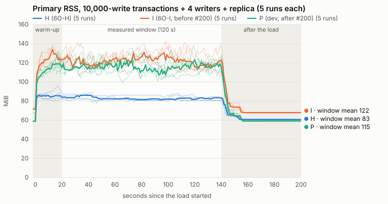

# v0.6.0 Phase 6O-I8: memory investigation (Investigation 1)

| | |
|---|---|
| Cell | the 10,000-write cell of `V0.6O-I8-LARGE-TRANSACTION-CONTENTION.md` |
| Sampling | every second: `VmRSS`, `VmHWM`, `RssAnon`, `RssFile`, `RssShmem`, threads, faults; `INFO replication` (offset, lag, queue depth and peaks); the diag builds add jemalloc's `allocated`, `active`, `resident`, `mapped`, `retained`, dirty pages, allocation requests, thread-cache refills and flushes, and bin-lock waits |
| Phases | warm-up 20 s, measured 120 s, after the load 60 s |
| Chart | `charts/e1-primary-rss.svg` |
| Raw | `raw/e1/` (production builds, 5 reps), `raw/e7b/` (jemalloc statistics, diag v2), `raw/e1d/` (dirty-page decay off), `raw/ex/` (px), `raw/et/`, `raw/et2/` (thread-cache settings), `raw/e5/` (heap profiles) |

## 1. Answer

| Question | Answer |
|---|---|
| Does primary RSS plateau over 120 s? | **Yes**, in every build: after the warm-up it holds a level. Least-squares slopes over the measured window range from −9.6 to +5.7 MiB/min across the 15 `e1` runs with no sign trend (medians H −0.8, I 0.0, P 0.0 MiB/min); within a run the four 30-second means move by up to 9 MiB (P) and 15 MiB (I) around that level without drifting |
| How much higher is P? | window mean **+33.7 MiB** (83.3 → 117.0 MiB, 1.40× paired [1.32–1.45]); window maximum +47 MiB; `VmHWM` 86.9 → 136.8 MiB |
| What is it? | **allocator-retained dirty pages**, not live data, not queues: jemalloc's live heap is the same (54.2 vs 54.1 MiB), its resident memory +35.7 MiB and its dirty pages +34.7 MiB (19.1 → 53.8 MiB) (`e7b`) |
| Why? | 6O-I's batched publish allocates a transaction's replication objects and then frees as many old ones in one trim, emptying whole slabs at once; jemalloc keeps freed pages dirty for `dirty_decay_ms` = 10 s before purging them (§3) |
| After the load? | P meets H's level about 10 s after the load and is below it from 16 s (median 59.1 against 60.7 MiB); I keeps 7 MiB more (its larger backlog frames, live data) |
| Bounded? | Yes, within what 120 s windows can show: no build drifts (median slopes 0.0 MiB/min for I and P); single runs swing either way by up to ±10 MiB/min within their window (+1.7 to +5.7 in four of P's and I's runs, −2.6 to −9.6 in others) and come back, as the 30-second means show. The extra disappears with immediate purging (decay 0), with px, and after the load. A soak longer than 120 s was not run for this cell |

## 2. The time series (`e1`, production builds, 5 runs each)

| median of 5 runs, MiB | H | I | P |
|---|---|---|---|
| RSS at the end of warm-up | 83.8 | 123.1 | 115.0 |
| RSS, measured-window mean | 83.3 | 122.2 | **117.0** |
| RSS, measured-window maximum | 87.0 | 138.6 | 133.7 |
| `VmHWM` | 86.9 | 139.2 | 136.8 |
| slope over the measured window (MiB/min) | −0.83 | −0.01 | −0.03 |
| `RssAnon`, window mean | 75.8 | 114.3 | 109.6 |
| RSS 10 s after the load | 64.5 | 73.5 | 64.6 |
| RSS 60 s after the load | 60.7 | 67.7 | **59.1** |
| replica RSS, maximum | 26.0 | 30.0 | 29.0 |

- **Plateau:** P's 30-second means, run by run: 111.9 109.3 108.3 111.6 · 121.0 117.2 116.8 116.6 · 116.7 120.1 115.8 114.2 · 113.8 123.2 115.1 119.5 · 118.3 114.4 113.5 121.7 MiB. They vary around a level; none rises window after window.
- **Anonymous memory:** the difference is all in `RssAnon` (+33.8 MiB); file-backed RSS is 7–8 MiB in every build.
- **Peak against retained:** the extra exists only while transactions run. After the load, P's RSS falls with jemalloc's purging (`dirty_decay_ms` 10,000, `background_thread:true`) and the backlog's trimming, and ends below H's.
- **6O-I's `VmHWM` figure** (+22–45 MiB after 20 s) was this plateau, read as a peak.
- **The quiet host gives the same ratio:** `et`'s default cell, at 0.37 CPU of foreign load, has P/H window RSS 1.407 [1.381–1.483].

## 3. Live data, queues or the allocator

jemalloc's statistics from the diag v2 primaries, each beside its label's production replica (`e7b`, median of 3 reps, measured window):

| | H | P | px |
|---|---|---|---|
| `allocated` (live) | 54.2 MiB | **54.1 MiB** | 54.2 MiB |
| `resident` | 80.4 MiB | **116.1 MiB** | 82.6 MiB |
| dirty pages | 19.1 MiB | **53.8 MiB** | 21.1 MiB |
| allocation requests per transaction | 60.4 k | 60.4 k | 60.4 k |
| thread-cache refills per transaction | 10.7 k | 20.5 k | 10.8 k |

| Candidate | Measured | Verdict |
|---|---|---|
| Live heap (store, backlog, queues) | `allocated` equal in H, P and px | not P's extra; I's +5–8 MiB *is* live (24-byte backlog frames) |
| Replication backlog | 16 MiB of payload by default in every build, full within a second at about 60 MB/s: about 250,000 frames, roughly 31 MiB with their `Arc`s (an estimate), in every build | in `allocated`, equal |
| Group side table | about 25 groups of 24 bytes | negligible |
| Per-replica send queue | bounded at 8 MiB charged; its frames are shared with the backlog; no production run disconnected its replica | in `allocated`, equal |
| In-flight transaction effects | one transaction's frames (10,000 × ≈ 64 B) while it publishes | < 1 MiB |
| Replica's group buffer | replica RSS +3 MiB (26 → 29 MiB): one 10,000-frame group before it applies | bounded by D1 (64 MiB) |
| Tokio tasks | not observable without `tokio_unstable`; 9 threads in every build | — |
| **Allocator retention** | resident +35.7 MiB with `allocated` unchanged; dirty pages +34.7 MiB; RSS falls with jemalloc's decay after the load; decay 0 removes it (below); px has H's RSS | **the cause** |

**Decay 0 (`raw/e1d/`, 3 reps × 120 s):** the production builds with jemalloc told to purge freed pages at once (`_RJEM_MALLOC_CONF=dirty_decay_ms:0`, primary only).

| decay 0, median of 3 | H | I | P |
|---|---|---|---|
| RSS, measured-window mean | 63.2 MiB | 70.3 MiB | **62.3 MiB** (paired 0.985 [0.982–0.986]) |
| RSS 60 s after the load | 60.1 MiB | 66.1 MiB | 58.3 MiB |
| minor page faults per transaction | 1,785 | 2,481 | **2,433** |
| kernel CPU per transaction | 2.92 ms | 3.89 ms | **3.82 ms** |
| user CPU per transaction | 11.78 ms | 12.24 ms | 12.21 ms |

With nothing kept dirty, P's RSS is H's; I's +7 MiB remains (live). P instead takes +650 minor faults (+0.9 ms of kernel time) per transaction, faulting back pages the batch emptied. That is about 2.6 MiB of pages per transaction, more than the transaction's own replication objects (≈ 1.7 MB): a purged slab page also held other objects' regions, so the amount is consistent with, not equal to, the batch's churn (review B F10). Decay 0 is a control, not a recommendation: it costs every build kernel CPU. `e1d` ran at about 0.4 CPU of foreign load; its ratios are paired within it.

**Thread-cache settings (`raw/et/`, `raw/et2/`):** P's window RSS stays at 115–124 MiB in every setting (default, 16,000 slots, 16,000 slots with the cache's GC effectively off, cache off), while H's rises from 82 to 89, 97 and 118 MiB; the P/H ratio falls (1.41 → 1.30 → 1.20 → 1.06) because H's RSS grows, not because P's shrinks. These settings therefore do not test P's extra RSS; its mechanism rests on the dirty pages (`e7b`), decay 0 and px above (review B round 2, N2).

### 3.1 Why the batch leaves dirty pages

A slab returns to the arena's dirty pool when its last region is freed. When one frame is published at a time (6O-H, px), each new frame's two objects are allocated where an old frame's two were just freed: slabs stay partly in use, and the thread cache recycles regions. When 20,000 objects are allocated and then 20,000 old ones freed, consecutive old allocations empty whole slabs together, and their pages go dirty. jemalloc purges dirty pages gradually over 10 s while about 90 transactions a second make more, so the pool settles at a steady size; without the load it drains (§2).

## 4. Allocations

| measured window | H | P | px |
|---|---|---|---|
| allocation requests per transaction (`small.nrequests`, `e7b`) | 60.4 k | 60.4 k | 60.4 k |
| thread-cache refill events per transaction (`small.nfills`) | 10.7 k | 20.5 k | 10.8 k |
| thread-cache flush events per transaction (`small.nflushes`) | 443 | 656 | 457 |
| allocation requests by site (heap profile, whole run, sampled: `raw/e5/jeprof-*.txt`) | EXEC frames 66.3%, store apply 32.9%, replication 17.0% | 66.1%, 32.9%, 17.2% | |
| frees per second | equal to allocations (± 0.01%) | | |

Nothing allocates more, and the same sites allocate. The batch order makes the thread caches refill from the arena twice as often (a fill event moves a batch of objects; `small.nmalloc` counts the objects moved) and flush half again as often.

## 5. Boundedness

- **RSS:** level over 120 s (no drift in any build's median; individual runs swing and return); returns to H's level after the load. Longer windows were not run for this cell.
- **Queues:** the per-replica queue is bounded by its byte budget (8 MiB charged) and frame cap, unchanged; no production run disconnected its replica (diag v1's H runs did, for the reason in `V0.6O-I8-LARGE-TRANSACTION-CONTENTION.md` §7, and are excluded).
- **Backlog and side table:** bounded by the backlog's byte limit; the side table is trimmed with it (6O-I's test `the_group_table_shrinks_with_the_backlog`).
- **Replica:** one group buffered at a time, bounded at 64 MiB charged (D1).
- **Allocator pool:** bounded by the decay: it disappears with decay 0 and within about 16 s of the load stopping at the default.
